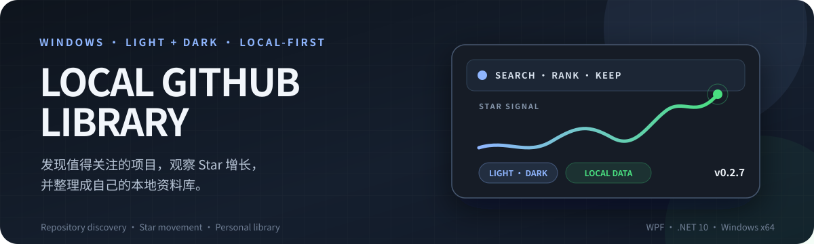
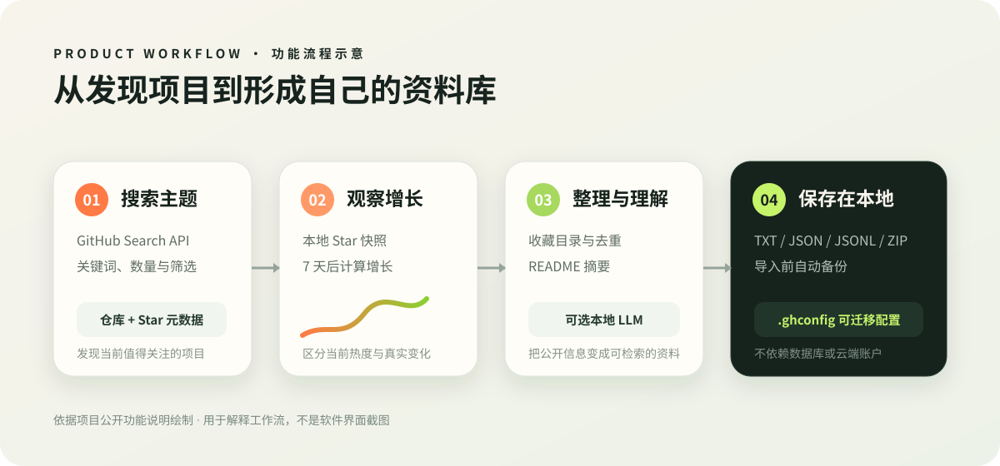
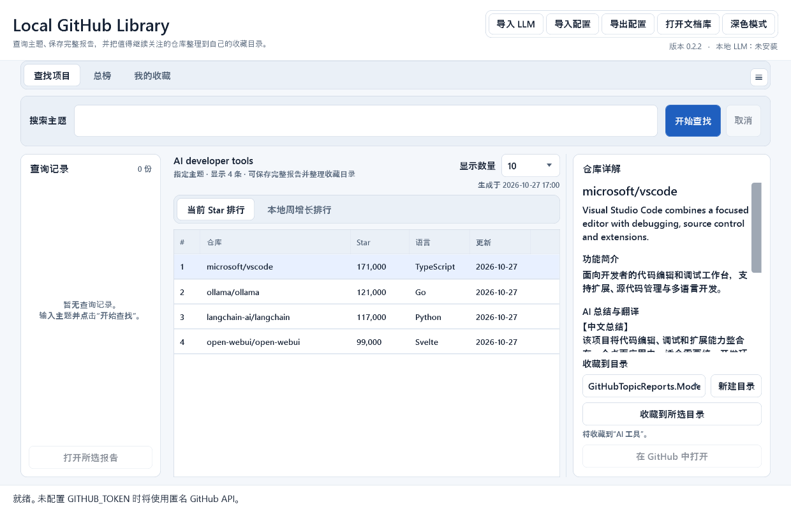
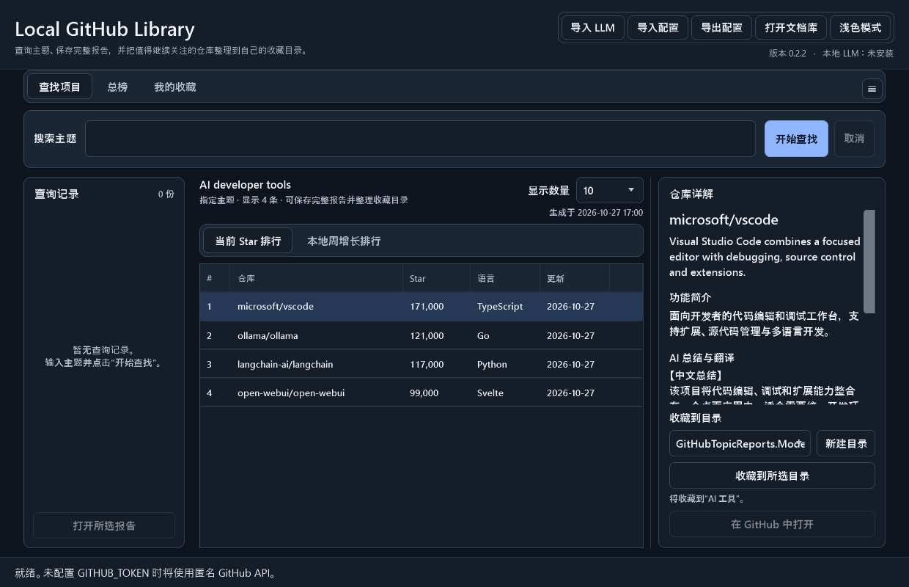
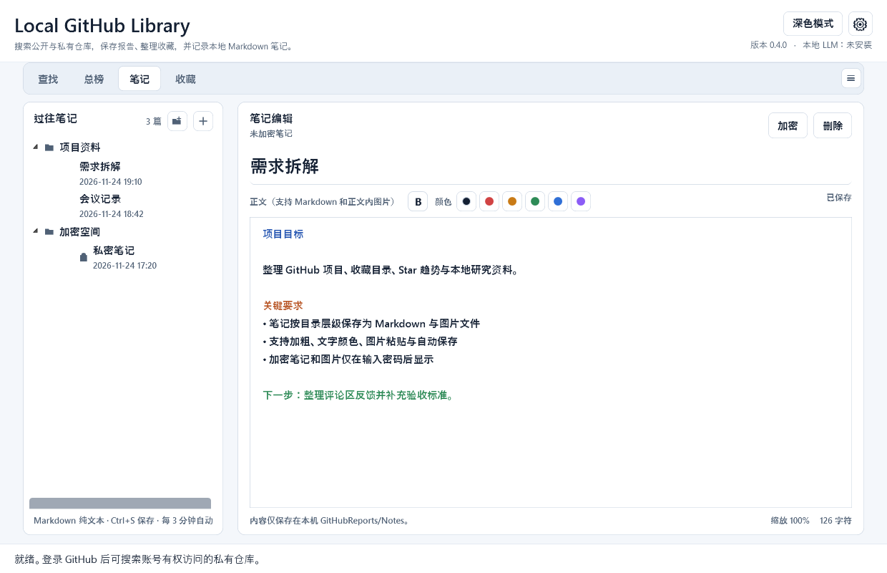

<p align="center">
  
</p>

<h1 align="center">Local GitHub Library</h1>

<p align="center">
  <strong>Discover projects worth following, track Star growth, and organize them into your own local library.</strong>
</p>

<p align="center">
  
  
  
  
</p>

<p align="center">
  <strong>English</strong>
  ·
  <a href="README.md">简体中文</a>
  ·
  <a href="README.zh-TW.md">繁體中文</a>
</p>

<p align="center">
  <a href="https://github.com/huaaorain/local-github-library/releases/latest"><strong>Download latest</strong></a>
  ·
  <a href="#user-content-features">Core capabilities</a>
  ·
  <a href="#user-content-screenshots">Screenshots</a>
  ·
  <a href="#user-content-quick-start">Quick start</a>
  ·
  <a href="#user-content-github-login">GitHub sign-in</a>
  ·
  <a href="#user-content-releases">All releases</a>
  ·
  <a href="https://github.com/huaaorain/local-github-library/issues">Report an issue</a>
</p>

---

> [!TIP]
> **Best for** people who need to discover repositories across topics, follow Star movement, and organize them into a durable local library.
> **It does not replace** a Git client, code editor, or the GitHub website itself.

## 💡 Why it exists

GitHub is good at finding one repository, but it is not designed to answer questions across topics and time:

- Which repositories in a technology area currently have the most Stars?
- How much has a project you follow grown after a week or longer?
- Which projects across GitHub are rising fastest today, this week, or this year?
- How can search results, favorites, and Star snapshots stay on your own computer?

**Local GitHub Library** brings those tasks into a database-free Windows desktop tool without requiring a cloud account. GitHub sign-in is optional, and business data remains in readable TXT, JSON, JSONL, and ZIP files that are easy to inspect, back up, and move.

<a id="features"></a>

## ✨ Core capabilities

<table>
  <colgroup>
    <col width="160">
    <col>
  </colgroup>
  <thead>
    <tr>
      <th>Module</th>
      <th>What it does</th>
    </tr>
  </thead>
  <tbody>
    <tr>
      <td><strong>Topic&#8239;search</strong></td>
      <td>Find the domain through GitHub Topics first, supplement with repository names and descriptions, and filter unrelated matches. When exact results are sparse, correct one or two mistyped English characters. Click Repository to sort by match relevance or Star to sort strictly by numeric Stars, then generate a readable TXT report.</td>
    </tr>
    <tr>
      <td><strong>GitHub&#8239;sign-in</strong></td>
      <td>Verify a GitHub account with a Fine-grained Personal Access Token, search private repositories the account can access, and view account and sign-out status. The token is encrypted with Windows DPAPI and excluded from reports and configuration exports.</td>
    </tr>
    <tr>
      <td><strong>Star&#8239;trends</strong></td>
      <td>Save historical snapshots for a topic and calculate a local Star-growth ranking after at least seven days.</td>
    </tr>
    <tr>
      <td><strong>Rankings</strong></td>
      <td>View Star-growth rankings for a day, week, month, two months, half year, or year, and inspect the current all-site Star ranking separately.</td>
    </tr>
    <tr>
      <td><strong>Favorites</strong></td>
      <td>Create, rename, or delete custom folders; search and batch-favorite repositories while skipping duplicates. Long-press a folder name to reorder folders, or a repository name to reorder projects, with smooth easing animations. Add notes, mark noted projects with an icon, and export all notes to a timestamped TXT file.</td>
    </tr>
    <tr>
      <td><strong>Local&#8239;notes</strong></td>
      <td>Organize notes in a folder tree and edit Markdown with inline images, bold text, and six text colors. Supports Ctrl+S, periodic auto-save, image copying, zoom, context actions, and drag ordering. Each note becomes a same-named Markdown file plus an images directory. Encrypted notes store both Markdown and images as ciphertext that can only be opened with the note password.</td>
    </tr>
    <tr>
      <td><strong>Insights</strong></td>
      <td>Extract project summaries from README files. An optional local LLM can create Chinese summaries and translations without a hosted inference API.</td>
    </tr>
    <tr>
      <td><strong>Local&#8239;data</strong></td>
      <td>Bundle reports, query history, favorites and notes, Star snapshots, and ranking caches into a `.ghconfig` package with an automatic backup before import.</td>
    </tr>
    <tr>
      <td><strong>Settings&#8239;and&#8239;tray</strong></td>
      <td>Use the header gear to manage LLM packages, configuration import/export, the local document library, and optional Windows startup. Panel widths, window size, maximized state, and table column widths are restored automatically. A custom global restore shortcut (Ctrl+Shift+D by default) can bring the app back from the taskbar or tray. Choose whether closing minimizes to the tray or exits. Light and dark themes remain available directly from the header.</td>
    </tr>
  </tbody>
</table>

<sub>\* Optional; core search, favorites, rankings, and reports continue to work without GitHub sign-in or the local LLM.</sub>

## 🧩 Workflow



_This is a workflow diagram based on the current source and public feature documentation, not a screenshot of the application._

GitHub APIs and public daily rankings supply discovery data. The workspace turns that data into search results, growth trends, favorites, and summaries, then organizes research in folder-based Markdown notes. Network access powers discovery; local notes, snapshots, and reports preserve long-term context.

<a id="screenshots"></a>

## 🖼️ Screenshots

| Light mode | Dark mode |
| --- | --- |
|  |  |



_Screenshots use non-sensitive demo data. The notes workspace shows the folder tree, rich-text toolbar, local Markdown editor, and encrypted-note entry._

<a id="quick-start"></a>

## 🚀 Quick start

### 1. Download

| Package | Size | Best for |
| --- | ---: | --- |
| [Standard Windows x64](https://github.com/huaaorain/local-github-library/releases/download/v0.4.1/LocalGithubLibrary-0.4.1-win-x64.zip) | About 84 MB | Local notes, folder ordering, GitHub sign-in, and local reports |
| [LLM model (optional)](docs/models/README.md) | About 1.04 GB | Downloaded separately; application upgrades reuse it |

### 2. Extract and run

Extract the complete archive into a normal directory where you have write access, then run `GitHubTopicReports.exe`.

> [!IMPORTANT]
> Keep the `runtimes` directory beside the executable. Do not move or copy only the EXE.

<a id="github-login"></a>

### 3. \* Sign in to GitHub and search private repositories

Anonymous GitHub API access can still search public repositories. To raise request limits or search private repositories, open the header gear `⚙`, go to **GitHub Account → Login**, paste a Personal Access Token, and select **Verify and sign in**.

<details>
<summary><strong>Create a Fine-grained Personal Access Token</strong></summary>

1. Open the [GitHub Fine-grained token creation page](https://github.com/settings/personal-access-tokens/new).
2. Enter a `Token name` such as `Local GitHub Library` and choose an `Expiration`.
3. Choose the personal account or organization that owns the repositories under `Resource owner`.
4. Under `Repository access`, choose `Only select repositories` and select the private repositories to search; choose `All repositories` only when that broader access is required.
5. Under `Repository permissions`, set `Metadata` to `Read-only` and `Contents` to `Read-only`.
6. Generate the token and copy the complete value beginning with `github_pat_...`. GitHub normally displays it only once.
7. Return to app settings, paste the token into the password field, and verify it.

`Metadata` provides repository information, while `Contents` allows README and project-detail retrieval. Organizations may require administrator approval for Fine-grained Tokens. See GitHub's official [Personal Access Token documentation](https://docs.github.com/authentication/keeping-your-account-and-data-secure/managing-your-personal-access-tokens).

If a Fine-grained Token cannot cover a required organization, a [Classic Token](https://github.com/settings/tokens/new) with the `repo` scope can be used as a broader fallback. Use it only when necessary.

</details>

The token is used only for GitHub API requests and is encrypted with Windows DPAPI for the current Windows user. Never place it in reports, issues, or screenshots.

## 🧠 \* Local LLM

`v0.2.0` adds an optional `.ghllm` extension package. After installation, repository details can stream Chinese translations and summaries. Without the package, search, rankings, favorites, and README summaries remain available.

Starting with the next application version, models are published as a separate GitHub Pre-release. Download them from the [LLM model library](docs/models/README.md); application upgrades do not require downloading the model again.

<details>
<summary><strong>Model requirements and prompt behavior</strong></summary>

- Recommended model: Qwen2.5 1.5B Instruct, Q4_K_M
- Model size: about 1.12 GB
- Recommended available memory: 6–8 GB
- Initial model load: about 2–10 seconds
- Summary and translation generation: about 8–10 seconds
- The inference runtime ships with the application; no OpenAI API key is required

Model packages and prompts are managed separately. Prompts can be imported, edited, saved, and exported, and support these placeholders:

```text
{{FullName}}      # required
{{Description}}
{{Topics}}
{{ReadmeSummary}}
```

See the [LLM model library](docs/models/README.md) to download a model and [docs/LLM_PACKAGE.md](docs/LLM_PACKAGE.md) for package validation and build details. Open **导入 LLM** from the header gear to import models and prompts.

</details>

## 🛡️ Data and privacy

The application maintains a `GitHubReports/` directory beside the executable:

```text
GitHubReports/
  Reports/               # Topic, favorites, and ranking reports
  Data/
    搜索记录.txt
    star-snapshots.jsonl
    favorites.json
    app-settings.json
    github-auth.bin       # DPAPI-encrypted GitHub login credential
    global-daily-ranks.zip
    error.log
  Backups/               # Created before configuration imports
  LLM/
    Packages/            # Optional local models
    prompt.txt
  Notes/                 # Folder-based local notes
    Project-notes/
      Requirements/
        Requirements.md
        images/
    Private/
      Confidential/
        Confidential.md.enc
        images/
          *.png.enc
```

- GitHub tokens are saved through app settings in `github-auth.bin`; advanced users can still use `GITHUB_TOKEN` or `github-token.txt`.
- `.ghconfig` excludes tokens, GitHub login credentials, and error logs.
- Imports create a backup and validate format, size, and path safety.
- Reports, favorites, and Star snapshots are not uploaded to third-party analytics or inference services.

<a id="releases"></a>

## 📦 All releases

<!-- release-catalog:start -->
Latest: [Local GitHub Library v0.4.0](https://github.com/huaaorain/local-github-library/releases/tag/v0.4.0)

| Version | Published | Release notes |
| --- | --- | --- |
| `v0.4.0` | 2026-11-24 | [Open](https://github.com/huaaorain/local-github-library/releases/tag/v0.4.0) |
| `v0.3.1` | 2026-11-23 | [Open](https://github.com/huaaorain/local-github-library/releases/tag/v0.3.1) |
| `v0.3.0` | 2026-11-20 | [Open](https://github.com/huaaorain/local-github-library/releases/tag/v0.3.0) |
| `v0.2.7` | 2026-11-19 | [Open](https://github.com/huaaorain/local-github-library/releases/tag/v0.2.7) |
| `v0.2.6` | 2026-11-06 | [Open](https://github.com/huaaorain/local-github-library/releases/tag/v0.2.6) |
| `v0.2.5` | 2026-11-06 | [Open](https://github.com/huaaorain/local-github-library/releases/tag/v0.2.5) |
| `v0.2.4` | 2026-11-05 | [Open](https://github.com/huaaorain/local-github-library/releases/tag/v0.2.4) |
| `models-qwen2.5-1.5b-v1` | 2026-11-05 | [Open](https://github.com/huaaorain/local-github-library/releases/tag/models-qwen2.5-1.5b-v1) |
| `v0.2.3` | 2026-11-04 | [Open](https://github.com/huaaorain/local-github-library/releases/tag/v0.2.3) |
| `v0.2.2` | 2026-11-02 | [Open](https://github.com/huaaorain/local-github-library/releases/tag/v0.2.2) |
| `v0.2.1` | 2026-10-27 | [Open](https://github.com/huaaorain/local-github-library/releases/tag/v0.2.1) |
| `v0.2.0` | 2026-10-26 | [Open](https://github.com/huaaorain/local-github-library/releases/tag/v0.2.0) |
| `v0.1.0` | 2026-10-26 | [Open](https://github.com/huaaorain/local-github-library/releases/tag/v0.1.0) |

<details>
<summary><strong>All version downloads</strong></summary>

### Local GitHub Library v0.4.0

Release notes: [Open](https://github.com/huaaorain/local-github-library/releases/tag/v0.4.0)

- [FILE_MANIFEST.md](https://github.com/huaaorain/local-github-library/releases/download/v0.4.0/FILE_MANIFEST.md) — 696 B
- [GitHubTopicReports.exe](https://github.com/huaaorain/local-github-library/releases/download/v0.4.0/GitHubTopicReports.exe) — 81.3 MB
- [LocalGithubLibrary-0.4.0-win-x64.zip](https://github.com/huaaorain/local-github-library/releases/download/v0.4.0/LocalGithubLibrary-0.4.0-win-x64.zip) — 83.3 MB
- [release-manifest.json](https://github.com/huaaorain/local-github-library/releases/download/v0.4.0/release-manifest.json) — 1.8 KB
- [SHA256SUMS.txt](https://github.com/huaaorain/local-github-library/releases/download/v0.4.0/SHA256SUMS.txt) — 192 B
- [Source code (zip)](https://github.com/huaaorain/local-github-library/archive/refs/tags/v0.4.0.zip)
- [Source code (tar.gz)](https://github.com/huaaorain/local-github-library/archive/refs/tags/v0.4.0.tar.gz)

### Local GitHub Library v0.3.1

Release notes: [Open](https://github.com/huaaorain/local-github-library/releases/tag/v0.3.1)

- [FILE_MANIFEST.md](https://github.com/huaaorain/local-github-library/releases/download/v0.3.1/FILE_MANIFEST.md) — 683 B
- [GitHubTopicReports.exe](https://github.com/huaaorain/local-github-library/releases/download/v0.3.1/GitHubTopicReports.exe) — 81.3 MB
- [LocalGithubLibrary-0.3.1-win-x64.zip](https://github.com/huaaorain/local-github-library/releases/download/v0.3.1/LocalGithubLibrary-0.3.1-win-x64.zip) — 83.6 MB
- [release-manifest.json](https://github.com/huaaorain/local-github-library/releases/download/v0.3.1/release-manifest.json) — 1.8 KB
- [SHA256SUMS.txt](https://github.com/huaaorain/local-github-library/releases/download/v0.3.1/SHA256SUMS.txt) — 192 B
- [Source code (zip)](https://github.com/huaaorain/local-github-library/archive/refs/tags/v0.3.1.zip)
- [Source code (tar.gz)](https://github.com/huaaorain/local-github-library/archive/refs/tags/v0.3.1.tar.gz)

### Local GitHub Library v0.3.0

Release notes: [Open](https://github.com/huaaorain/local-github-library/releases/tag/v0.3.0)

- [FILE_MANIFEST.md](https://github.com/huaaorain/local-github-library/releases/download/v0.3.0/FILE_MANIFEST.md) — 683 B
- [GitHubTopicReports.exe](https://github.com/huaaorain/local-github-library/releases/download/v0.3.0/GitHubTopicReports.exe) — 81.3 MB
- [LocalGithubLibrary-0.3.0-win-x64.zip](https://github.com/huaaorain/local-github-library/releases/download/v0.3.0/LocalGithubLibrary-0.3.0-win-x64.zip) — 83.6 MB
- [release-manifest.json](https://github.com/huaaorain/local-github-library/releases/download/v0.3.0/release-manifest.json) — 1.8 KB
- [SHA256SUMS.txt](https://github.com/huaaorain/local-github-library/releases/download/v0.3.0/SHA256SUMS.txt) — 192 B
- [Source code (zip)](https://github.com/huaaorain/local-github-library/archive/refs/tags/v0.3.0.zip)
- [Source code (tar.gz)](https://github.com/huaaorain/local-github-library/archive/refs/tags/v0.3.0.tar.gz)

### Local GitHub Library 0.2.7

Release notes: [Open](https://github.com/huaaorain/local-github-library/releases/tag/v0.2.7)

- [FILE_MANIFEST.md](https://github.com/huaaorain/local-github-library/releases/download/v0.2.7/FILE_MANIFEST.md) — 695 B
- [GitHubTopicReports.exe](https://github.com/huaaorain/local-github-library/releases/download/v0.2.7/GitHubTopicReports.exe) — 81.3 MB
- [LocalGithubLibrary-0.2.7-win-x64.zip](https://github.com/huaaorain/local-github-library/releases/download/v0.2.7/LocalGithubLibrary-0.2.7-win-x64.zip) — 83.6 MB
- [release-manifest.json](https://github.com/huaaorain/local-github-library/releases/download/v0.2.7/release-manifest.json) — 1.8 KB
- [SHA256SUMS.txt](https://github.com/huaaorain/local-github-library/releases/download/v0.2.7/SHA256SUMS.txt) — 192 B
- [Source code (zip)](https://github.com/huaaorain/local-github-library/archive/refs/tags/v0.2.7.zip)
- [Source code (tar.gz)](https://github.com/huaaorain/local-github-library/archive/refs/tags/v0.2.7.tar.gz)

### Local GitHub Library 0.2.6

Release notes: [Open](https://github.com/huaaorain/local-github-library/releases/tag/v0.2.6)

- [FILE_MANIFEST.md](https://github.com/huaaorain/local-github-library/releases/download/v0.2.6/FILE_MANIFEST.md) — 695 B
- [GitHubTopicReports.exe](https://github.com/huaaorain/local-github-library/releases/download/v0.2.6/GitHubTopicReports.exe) — 81.2 MB
- [LocalGithubLibrary-0.2.6-win-x64.zip](https://github.com/huaaorain/local-github-library/releases/download/v0.2.6/LocalGithubLibrary-0.2.6-win-x64.zip) — 83.6 MB
- [release-manifest.json](https://github.com/huaaorain/local-github-library/releases/download/v0.2.6/release-manifest.json) — 1.8 KB
- [SHA256SUMS.txt](https://github.com/huaaorain/local-github-library/releases/download/v0.2.6/SHA256SUMS.txt) — 192 B
- [Source code (zip)](https://github.com/huaaorain/local-github-library/archive/refs/tags/v0.2.6.zip)
- [Source code (tar.gz)](https://github.com/huaaorain/local-github-library/archive/refs/tags/v0.2.6.tar.gz)

### Local GitHub Library 0.2.5

Release notes: [Open](https://github.com/huaaorain/local-github-library/releases/tag/v0.2.5)

- [FILE_MANIFEST.md](https://github.com/huaaorain/local-github-library/releases/download/v0.2.5/FILE_MANIFEST.md) — 695 B
- [GitHubTopicReports.exe](https://github.com/huaaorain/local-github-library/releases/download/v0.2.5/GitHubTopicReports.exe) — 80.7 MB
- [LocalGithubLibrary-0.2.5-win-x64.zip](https://github.com/huaaorain/local-github-library/releases/download/v0.2.5/LocalGithubLibrary-0.2.5-win-x64.zip) — 83.0 MB
- [release-manifest.json](https://github.com/huaaorain/local-github-library/releases/download/v0.2.5/release-manifest.json) — 1.8 KB
- [SHA256SUMS.txt](https://github.com/huaaorain/local-github-library/releases/download/v0.2.5/SHA256SUMS.txt) — 192 B
- [Source code (zip)](https://github.com/huaaorain/local-github-library/archive/refs/tags/v0.2.5.zip)
- [Source code (tar.gz)](https://github.com/huaaorain/local-github-library/archive/refs/tags/v0.2.5.tar.gz)

### Local GitHub Library 0.2.4

Release notes: [Open](https://github.com/huaaorain/local-github-library/releases/tag/v0.2.4)

- [FILE_MANIFEST.md](https://github.com/huaaorain/local-github-library/releases/download/v0.2.4/FILE_MANIFEST.md) — 695 B
- [GitHubTopicReports.exe](https://github.com/huaaorain/local-github-library/releases/download/v0.2.4/GitHubTopicReports.exe) — 70.6 MB
- [LocalGithubLibrary-0.2.4-win-x64.zip](https://github.com/huaaorain/local-github-library/releases/download/v0.2.4/LocalGithubLibrary-0.2.4-win-x64.zip) — 73.1 MB
- [release-manifest.json](https://github.com/huaaorain/local-github-library/releases/download/v0.2.4/release-manifest.json) — 1.8 KB
- [SHA256SUMS.txt](https://github.com/huaaorain/local-github-library/releases/download/v0.2.4/SHA256SUMS.txt) — 192 B
- [Source code (zip)](https://github.com/huaaorain/local-github-library/archive/refs/tags/v0.2.4.zip)
- [Source code (tar.gz)](https://github.com/huaaorain/local-github-library/archive/refs/tags/v0.2.4.tar.gz)

### LLM 模型库 - Qwen2.5 1.5B Q4_K_M v1

Release notes: [Open](https://github.com/huaaorain/local-github-library/releases/tag/models-qwen2.5-1.5b-v1)

- [FILE_MANIFEST.md](https://github.com/huaaorain/local-github-library/releases/download/models-qwen2.5-1.5b-v1/FILE_MANIFEST.md) — 516 B
- [Qwen2.5-1.5B-Instruct-Q4_K_M.ghllm](https://github.com/huaaorain/local-github-library/releases/download/models-qwen2.5-1.5b-v1/Qwen2.5-1.5B-Instruct-Q4_K_M.ghllm) — 1.0 GB
- [release-manifest.json](https://github.com/huaaorain/local-github-library/releases/download/models-qwen2.5-1.5b-v1/release-manifest.json) — 1.1 KB
- [SHA256SUMS.txt](https://github.com/huaaorain/local-github-library/releases/download/models-qwen2.5-1.5b-v1/SHA256SUMS.txt) — 101 B
- [Source code (zip)](https://github.com/huaaorain/local-github-library/archive/refs/tags/models-qwen2.5-1.5b-v1.zip)
- [Source code (tar.gz)](https://github.com/huaaorain/local-github-library/archive/refs/tags/models-qwen2.5-1.5b-v1.tar.gz)

### Local GitHub Library 0.2.3

Release notes: [Open](https://github.com/huaaorain/local-github-library/releases/tag/v0.2.3)

- [FILE_MANIFEST.md](https://github.com/huaaorain/local-github-library/releases/download/v0.2.3/FILE_MANIFEST.md) — 1.0 KB
- [GitHubTopicReports.exe](https://github.com/huaaorain/local-github-library/releases/download/v0.2.3/GitHubTopicReports.exe) — 70.6 MB
- [LocalGithubLibrary-0.2.3-full-win-x64.zip](https://github.com/huaaorain/local-github-library/releases/download/v0.2.3/LocalGithubLibrary-0.2.3-full-win-x64.zip) — 1.1 GB
- [LocalGithubLibrary-0.2.3-win-x64.zip](https://github.com/huaaorain/local-github-library/releases/download/v0.2.3/LocalGithubLibrary-0.2.3-win-x64.zip) — 73.0 MB
- [Qwen2.5-1.5B-Instruct-Q4_K_M.ghllm](https://github.com/huaaorain/local-github-library/releases/download/v0.2.3/Qwen2.5-1.5B-Instruct-Q4_K_M.ghllm) — 1.0 GB
- [release-manifest.json](https://github.com/huaaorain/local-github-library/releases/download/v0.2.3/release-manifest.json) — 3.1 KB
- [SHA256SUMS.txt](https://github.com/huaaorain/local-github-library/releases/download/v0.2.3/SHA256SUMS.txt) — 401 B
- [Source code (zip)](https://github.com/huaaorain/local-github-library/archive/refs/tags/v0.2.3.zip)
- [Source code (tar.gz)](https://github.com/huaaorain/local-github-library/archive/refs/tags/v0.2.3.tar.gz)

### Local GitHub Library 0.2.2

Release notes: [Open](https://github.com/huaaorain/local-github-library/releases/tag/v0.2.2)

- [FILE_MANIFEST.md](https://github.com/huaaorain/local-github-library/releases/download/v0.2.2/FILE_MANIFEST.md) — 1.0 KB
- [GitHubTopicReports.exe](https://github.com/huaaorain/local-github-library/releases/download/v0.2.2/GitHubTopicReports.exe) — 70.6 MB
- [LocalGithubLibrary-0.2.2-full-win-x64.zip](https://github.com/huaaorain/local-github-library/releases/download/v0.2.2/LocalGithubLibrary-0.2.2-full-win-x64.zip) — 1.1 GB
- [LocalGithubLibrary-0.2.2-win-x64.zip](https://github.com/huaaorain/local-github-library/releases/download/v0.2.2/LocalGithubLibrary-0.2.2-win-x64.zip) — 72.8 MB
- [Qwen2.5-1.5B-Instruct-Q4_K_M.ghllm](https://github.com/huaaorain/local-github-library/releases/download/v0.2.2/Qwen2.5-1.5B-Instruct-Q4_K_M.ghllm) — 1.0 GB
- [release-manifest.json](https://github.com/huaaorain/local-github-library/releases/download/v0.2.2/release-manifest.json) — 2.0 KB
- [SHA256SUMS.txt](https://github.com/huaaorain/local-github-library/releases/download/v0.2.2/SHA256SUMS.txt) — 401 B
- [Source code (zip)](https://github.com/huaaorain/local-github-library/archive/refs/tags/v0.2.2.zip)
- [Source code (tar.gz)](https://github.com/huaaorain/local-github-library/archive/refs/tags/v0.2.2.tar.gz)

### Local GitHub Library 0.2.1

Release notes: [Open](https://github.com/huaaorain/local-github-library/releases/tag/v0.2.1)

- [FILE_MANIFEST.md](https://github.com/huaaorain/local-github-library/releases/download/v0.2.1/FILE_MANIFEST.md) — 1.0 KB
- [GitHubTopicReports.exe](https://github.com/huaaorain/local-github-library/releases/download/v0.2.1/GitHubTopicReports.exe) — 70.6 MB
- [LocalGithubLibrary-0.2.1-full-win-x64.zip](https://github.com/huaaorain/local-github-library/releases/download/v0.2.1/LocalGithubLibrary-0.2.1-full-win-x64.zip) — 1.1 GB
- [LocalGithubLibrary-0.2.1-win-x64.zip](https://github.com/huaaorain/local-github-library/releases/download/v0.2.1/LocalGithubLibrary-0.2.1-win-x64.zip) — 72.8 MB
- [Qwen2.5-1.5B-Instruct-Q4_K_M.ghllm](https://github.com/huaaorain/local-github-library/releases/download/v0.2.1/Qwen2.5-1.5B-Instruct-Q4_K_M.ghllm) — 1.0 GB
- [release-manifest.json](https://github.com/huaaorain/local-github-library/releases/download/v0.2.1/release-manifest.json) — 2.0 KB
- [SHA256SUMS.txt](https://github.com/huaaorain/local-github-library/releases/download/v0.2.1/SHA256SUMS.txt) — 401 B
- [Source code (zip)](https://github.com/huaaorain/local-github-library/archive/refs/tags/v0.2.1.zip)
- [Source code (tar.gz)](https://github.com/huaaorain/local-github-library/archive/refs/tags/v0.2.1.tar.gz)

### Local GitHub Library 0.2.0

Release notes: [Open](https://github.com/huaaorain/local-github-library/releases/tag/v0.2.0)

- [GitHubTopicReports.exe](https://github.com/huaaorain/local-github-library/releases/download/v0.2.0/GitHubTopicReports.exe) — 70.6 MB
- [LocalGithubLibrary-0.2.0-full-win-x64.zip](https://github.com/huaaorain/local-github-library/releases/download/v0.2.0/LocalGithubLibrary-0.2.0-full-win-x64.zip) — 1.1 GB
- [LocalGithubLibrary-0.2.0-source.zip](https://github.com/huaaorain/local-github-library/releases/download/v0.2.0/LocalGithubLibrary-0.2.0-source.zip) — 75.3 KB
- [LocalGithubLibrary-0.2.0-win-x64.zip](https://github.com/huaaorain/local-github-library/releases/download/v0.2.0/LocalGithubLibrary-0.2.0-win-x64.zip) — 73.2 MB
- [Qwen2.5-1.5B-Instruct-Q4_K_M.ghllm](https://github.com/huaaorain/local-github-library/releases/download/v0.2.0/Qwen2.5-1.5B-Instruct-Q4_K_M.ghllm) — 1.0 GB
- [RELEASE_NOTES_0.2.0.md](https://github.com/huaaorain/local-github-library/releases/download/v0.2.0/RELEASE_NOTES_0.2.0.md) — 3.1 KB
- [SHA256SUMS.txt](https://github.com/huaaorain/local-github-library/releases/download/v0.2.0/SHA256SUMS.txt) — 598 B
- [Source code (zip)](https://github.com/huaaorain/local-github-library/archive/refs/tags/v0.2.0.zip)
- [Source code (tar.gz)](https://github.com/huaaorain/local-github-library/archive/refs/tags/v0.2.0.tar.gz)

### Local GitHub Library 0.1.0

Release notes: [Open](https://github.com/huaaorain/local-github-library/releases/tag/v0.1.0)

- [GitHubTopicReports-v0.1.0-win-x64.exe](https://github.com/huaaorain/local-github-library/releases/download/v0.1.0/GitHubTopicReports-v0.1.0-win-x64.exe) — 61.9 MB
- [Source code (zip)](https://github.com/huaaorain/local-github-library/archive/refs/tags/v0.1.0.zip)
- [Source code (tar.gz)](https://github.com/huaaorain/local-github-library/archive/refs/tags/v0.1.0.tar.gz)

</details>
<!-- release-catalog:end -->

## 🖥️ Requirements

- Windows 10 or Windows 11, 64-bit
- Intel or AMD processor
- Access to `github.com` and `api.github.com`
- Network access for search, README retrieval, and current rankings
- Favorite browsing and downloaded ranking caches work offline
- Note editing, image management, encrypted notes, and saved-note browsing work offline

## ⚠️ Known limitations

- GitHub Search API returns at most 1000 results, and anonymous requests have a low quota.
- Signed-in private-repository supplementation matches up to the 1,000 most recently updated accessible repositories.
- The all-site growth ranking depends on the coverage of the public [OpenGithubs daily ranking](https://github.com/OpenGithubs/github-daily-rank).
- Only Windows x64 builds are currently provided.
- The unsigned EXE may trigger a Windows SmartScreen warning.
- Encryption protects note text and image contents; titles, folder names, and file counts may still be visible from local paths. Forgotten passwords cannot be recovered.
- Notes from 0.3.x migrate automatically. A previously encrypted note needs to be unlocked and saved before its placeholder folder can be renamed to the real note title.
- This project uses PolyForm Noncommercial 1.0.0, permits noncommercial use only, and is not an OSI open-source license. Commercial use requires separate authorization.

## 🔧 Build from source

<details>
<summary><strong>Build, run, and publish</strong></summary>

```powershell
dotnet restore
dotnet build .\GitHubTopicReports.csproj -c Release
dotnet run --project .\GitHubTopicReports.csproj
```

Publish a self-contained Windows x64 build:

```powershell
.\publish.ps1
```

The publish script creates a single-file application and copies the LLamaSharp CPU native runtime to `dist\runtimes\win-x64\native`. That directory must be distributed with the application.

</details>

## 🤝 Contributing

Issues and pull requests are welcome. Before submitting:

- Do not include tokens, personal reports, favorites, or local logs.
- Complete a Release build.
- Increment `formatVersion` when changing the configuration format.

## 📝 Release history

- [0.4.1: custom global restore hotkey, saved table widths, and startup isolation](docs/releases/v0.4.1.en.md)
- [0.4.0: folder-based notes, rich editing, encrypted images, and safe writes](docs/releases/v0.4.0.en.md)
- [0.3.1: favorite folder drag ordering and restart layout restoration](docs/releases/v0.3.1.en.md)
- [0.3.0: GitHub sign-in, private repository search, and secure credential storage](docs/releases/v0.3.0.en.md)
- [0.2.7: favorite drag ordering, note markers, Windows startup, and default directory view](docs/releases/v0.2.7.en.md)
- [0.2.6: typo-tolerant search and multi-resolution app icon](docs/releases/v0.2.6.en.md)
- [0.2.5: app settings, system tray, and configurable close behavior](docs/releases/v0.2.5.en.md)
- [0.2.4: favorite notes, folder management actions, and reusable model releases](docs/releases/v0.2.4.en.md)
- [0.2.3: application-wide design system, light/dark themes, and interaction states](docs/releases/v0.2.3.en.md)
- [0.2.2: cross-domain search relevance, numeric sorting, and stable result ordering](docs/releases/v0.2.2.md)
- [0.2.1: resizable workspace panes, reset-layout control, and UI polish](docs/releases/v0.2.1.md)
- [0.2.0: local LLM, prompt management, and favorites fixes](docs/releases/v0.2.0.md)
- [0.1.0: first public release](docs/releases/v0.1.0.md)
- Full history: [CHANGELOG.md](CHANGELOG.md)

## 🙏 Acknowledgements

- [GitHub REST API](https://docs.github.com/rest)
- [OpenGithubs GitHub Daily Rank](https://github.com/OpenGithubs/github-daily-rank)
- [.NET](https://dotnet.microsoft.com/) and WPF
- [LLamaSharp](https://github.com/SciSharp/LLamaSharp) and [llama.cpp](https://github.com/ggml-org/llama.cpp)
- Qwen2.5 model (Apache-2.0)

## 📄 License

This project uses PolyForm Noncommercial 1.0.0, permits noncommercial use only, and is not an OSI open-source license. Commercial use requires separate authorization. See [LICENSE](LICENSE) for the complete terms.
