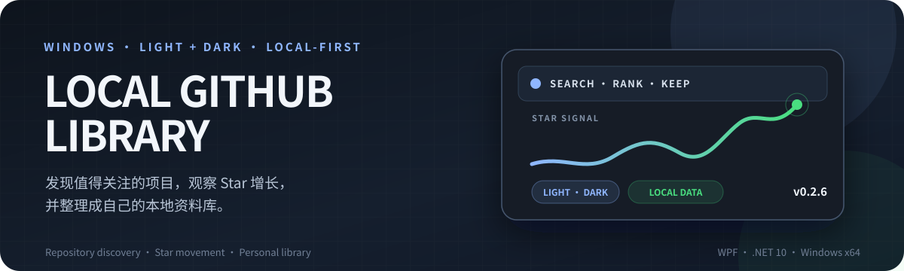
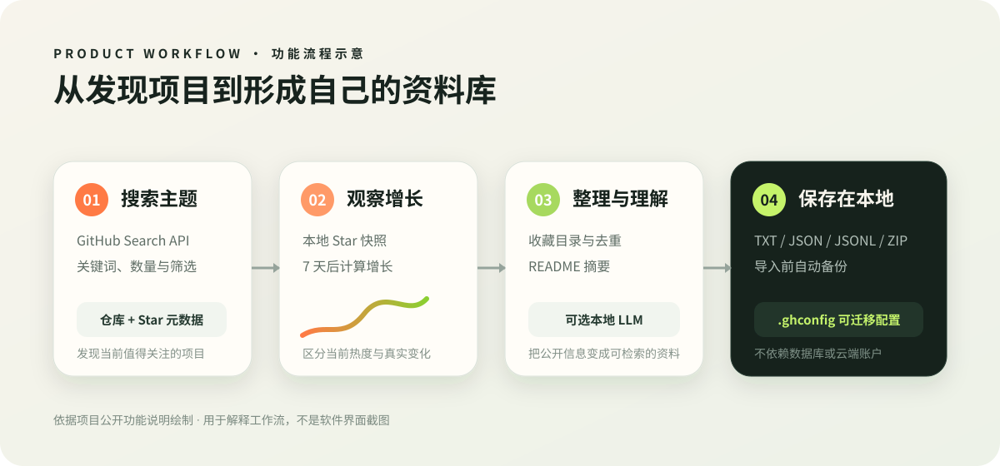
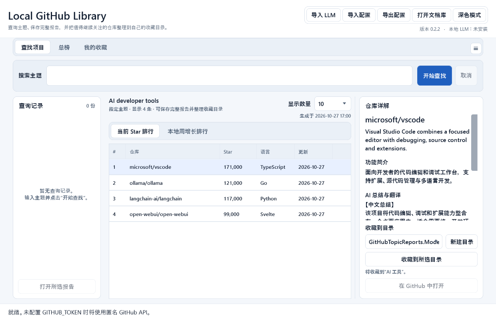
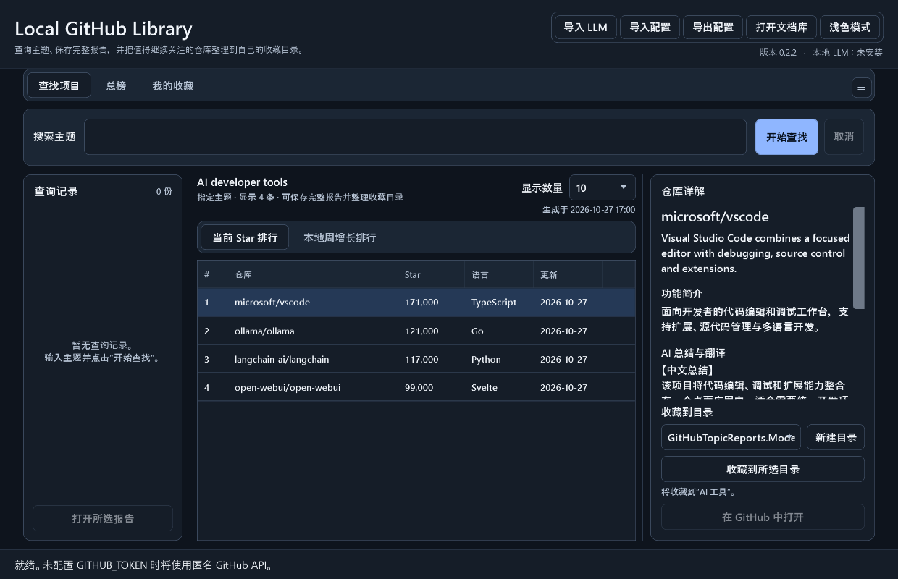

<p align="center">
  
</p>

<h1 align="center">Local GitHub Library</h1>

<p align="center">
  <strong>Discover projects worth following, track Star growth, and organize them into your own local library.</strong>
</p>

<p align="center">
  
  
  
  
</p>

<p align="center">
  <strong>English</strong>
  ·
  <a href="README.md">简体中文</a>
  ·
  <a href="README.zh-TW.md">繁體中文</a>
</p>

<p align="center">
  <a href="https://github.com/huaaorain/local-github-library/releases/latest"><strong>Download latest</strong></a>
  ·
  <a href="#user-content-features">Core capabilities</a>
  ·
  <a href="#user-content-screenshots">Screenshots</a>
  ·
  <a href="#user-content-quick-start">Quick start</a>
  ·
  <a href="#user-content-releases">All releases</a>
  ·
  <a href="https://github.com/huaaorain/local-github-library/issues">Report an issue</a>
</p>

---

> [!TIP]
> **Best for** people who need to discover repositories across topics, follow Star movement, and organize them into a durable local library.
> **It does not replace** a Git client, code editor, or the GitHub website itself.

## 💡 Why it exists

GitHub is good at finding one repository, but it is not designed to answer questions across topics and time:

- Which repositories in a technology area currently have the most Stars?
- How much has a project you follow grown after a week or longer?
- Which projects across GitHub are rising fastest today, this week, or this year?
- How can search results, favorites, and Star snapshots stay on your own computer?

**Local GitHub Library** brings those tasks into a database-free Windows desktop tool that requires no cloud account. Business data is stored in readable TXT, JSON, JSONL, and ZIP files that are easy to inspect, back up, and move.

<a id="features"></a>

## ✨ Core capabilities

<table>
  <colgroup>
    <col width="160">
    <col>
  </colgroup>
  <thead>
    <tr>
      <th>Module</th>
      <th>What it does</th>
    </tr>
  </thead>
  <tbody>
    <tr>
      <td><strong>Topic&#8239;search</strong></td>
      <td>Find the domain through GitHub Topics first, supplement with repository names and descriptions, and filter unrelated matches. Click Repository to sort by match relevance or Star to sort strictly by numeric Stars, then generate a readable TXT report.</td>
    </tr>
    <tr>
      <td><strong>Star&#8239;trends</strong></td>
      <td>Save historical snapshots for a topic and calculate a local Star-growth ranking after at least seven days.</td>
    </tr>
    <tr>
      <td><strong>Rankings</strong></td>
      <td>View Star-growth rankings for a day, week, month, two months, half year, or year, and inspect the current all-site Star ranking separately.</td>
    </tr>
    <tr>
      <td><strong>Favorites</strong></td>
      <td>Create, rename, or delete custom folders; search and batch-favorite repositories while skipping duplicates. Add, edit, or delete a local note for each project and export all notes to a timestamped TXT file.</td>
    </tr>
    <tr>
      <td><strong>Insights</strong></td>
      <td>Extract project summaries from README files. An optional local LLM can create Chinese summaries and translations without a hosted inference API.</td>
    </tr>
    <tr>
      <td><strong>Local&#8239;data</strong></td>
      <td>Bundle reports, query history, favorites and notes, Star snapshots, and ranking caches into a `.ghconfig` package with an automatic backup before import.</td>
    </tr>
    <tr>
      <td><strong>Settings&#8239;and&#8239;tray</strong></td>
      <td>Use the header gear to manage LLM packages, configuration import/export, and the local document library. Choose whether closing minimizes to the tray or exits, with an optional confirmation on every close. Light and dark themes remain available directly from the header.</td>
    </tr>
  </tbody>
</table>

## 🧩 Workflow



_This is a workflow diagram based on the current source and public feature documentation, not a screenshot of the application._

GitHub APIs and public daily rankings supply discovery data. The workspace turns that data into search results, growth trends, favorites, and summaries, then stores everything in local files. Network access powers discovery; snapshots and reports provide continuity.

<a id="screenshots"></a>

## 🖼️ Screenshots

| Light mode | Dark mode |
| --- | --- |
|  |  |

_Screenshots use non-sensitive demo data. The header theme button switches modes immediately without changing queries, favorites, or reports._

<a id="quick-start"></a>

## 🚀 Quick start

### 1. Download

| Package | Size | Best for |
| --- | ---: | --- |
| [Standard Windows x64](https://github.com/huaaorain/local-github-library/releases/download/v0.2.5/LocalGithubLibrary-0.2.5-win-x64.zip) | About 81 MB | Search, rankings, favorites, notes, app settings, and tray controls |
| [LLM model (optional)](docs/models/README.md) | About 1.04 GB | Downloaded separately; application upgrades reuse it |

### 2. Extract and run

Extract the complete archive into a normal directory where you have write access, then run `GitHubTopicReports.exe`.

> [!IMPORTANT]
> Keep the `runtimes` directory beside the executable. Do not move or copy only the EXE.

### 3. Optionally configure a GitHub token

Anonymous GitHub API access works, but the request limit is low. For more reliable search and rankings, create `github-token.txt` beside the executable and place only a read-only token inside it.

```powershell
# The environment variable is also supported
$env:GITHUB_TOKEN = "your_token"
```

Do not commit or share the token.

## 🧠 Local LLM

`v0.2.0` adds an optional `.ghllm` extension package. After installation, repository details can stream Chinese translations and summaries. Without the package, search, rankings, favorites, and README summaries remain available.

Starting with the next application version, models are published as a separate GitHub Pre-release. Download them from the [LLM model library](docs/models/README.md); application upgrades do not require downloading the model again.

<details>
<summary><strong>Model requirements and prompt behavior</strong></summary>

- Recommended model: Qwen2.5 1.5B Instruct, Q4_K_M
- Model size: about 1.12 GB
- Recommended available memory: 6–8 GB
- Initial model load: about 2–10 seconds
- Summary and translation generation: about 8–10 seconds
- The inference runtime ships with the application; no OpenAI API key is required

Model packages and prompts are managed separately. Prompts can be imported, edited, saved, and exported, and support these placeholders:

```text
{{FullName}}      # required
{{Description}}
{{Topics}}
{{ReadmeSummary}}
```

See the [LLM model library](docs/models/README.md) to download a model and [docs/LLM_PACKAGE.md](docs/LLM_PACKAGE.md) for package validation and build details. Open **导入 LLM** from the header gear to import models and prompts.

</details>

## 🛡️ Data and privacy

The application maintains a `GitHubReports/` directory beside the executable:

```text
GitHubReports/
  Reports/               # Topic, favorites, and ranking reports
  Data/
    搜索记录.txt
    star-snapshots.jsonl
    favorites.json
    app-settings.json
    global-daily-ranks.zip
    error.log
  Backups/               # Created before configuration imports
  LLM/
    Packages/            # Optional local models
    prompt.txt
```

- GitHub tokens are read only from the environment or `github-token.txt`.
- `.ghconfig` excludes tokens and error logs.
- Imports create a backup and validate format, size, and path safety.
- Reports, favorites, and Star snapshots are not uploaded to third-party analytics or inference services.

<a id="releases"></a>

## 📦 All releases

<!-- release-catalog:start -->
Latest: [Local GitHub Library 0.2.4](https://github.com/huaaorain/local-github-library/releases/tag/v0.2.4)

| Version | Published | Release notes |
| --- | --- | --- |
| `v0.2.4` | 2026-11-05 | [Open](https://github.com/huaaorain/local-github-library/releases/tag/v0.2.4) |
| `v0.2.3` | 2026-11-04 | [Open](https://github.com/huaaorain/local-github-library/releases/tag/v0.2.3) |
| `v0.2.2` | 2026-11-02 | [Open](https://github.com/huaaorain/local-github-library/releases/tag/v0.2.2) |
| `v0.2.1` | 2026-10-27 | [Open](https://github.com/huaaorain/local-github-library/releases/tag/v0.2.1) |
| `v0.2.0` | 2026-10-26 | [Open](https://github.com/huaaorain/local-github-library/releases/tag/v0.2.0) |
| `v0.1.0` | 2026-10-26 | [Open](https://github.com/huaaorain/local-github-library/releases/tag/v0.1.0) |

<details>
<summary><strong>All version downloads</strong></summary>

### Local GitHub Library 0.2.4

Release notes: [Open](https://github.com/huaaorain/local-github-library/releases/tag/v0.2.4)

- [FILE_MANIFEST.md](https://github.com/huaaorain/local-github-library/releases/download/v0.2.4/FILE_MANIFEST.md) — 695 B
- [GitHubTopicReports.exe](https://github.com/huaaorain/local-github-library/releases/download/v0.2.4/GitHubTopicReports.exe) — 70.6 MB
- [LocalGithubLibrary-0.2.4-win-x64.zip](https://github.com/huaaorain/local-github-library/releases/download/v0.2.4/LocalGithubLibrary-0.2.4-win-x64.zip) — 73.1 MB
- [release-manifest.json](https://github.com/huaaorain/local-github-library/releases/download/v0.2.4/release-manifest.json) — 1.8 KB
- [SHA256SUMS.txt](https://github.com/huaaorain/local-github-library/releases/download/v0.2.4/SHA256SUMS.txt) — 192 B
- [Source code (zip)](https://github.com/huaaorain/local-github-library/archive/refs/tags/v0.2.4.zip)
- [Source code (tar.gz)](https://github.com/huaaorain/local-github-library/archive/refs/tags/v0.2.4.tar.gz)

### Local GitHub Library 0.2.3

Release notes: [Open](https://github.com/huaaorain/local-github-library/releases/tag/v0.2.3)

- [FILE_MANIFEST.md](https://github.com/huaaorain/local-github-library/releases/download/v0.2.3/FILE_MANIFEST.md) — 1.0 KB
- [GitHubTopicReports.exe](https://github.com/huaaorain/local-github-library/releases/download/v0.2.3/GitHubTopicReports.exe) — 70.6 MB
- [LocalGithubLibrary-0.2.3-full-win-x64.zip](https://github.com/huaaorain/local-github-library/releases/download/v0.2.3/LocalGithubLibrary-0.2.3-full-win-x64.zip) — 1.1 GB
- [LocalGithubLibrary-0.2.3-win-x64.zip](https://github.com/huaaorain/local-github-library/releases/download/v0.2.3/LocalGithubLibrary-0.2.3-win-x64.zip) — 73.0 MB
- [Qwen2.5-1.5B-Instruct-Q4_K_M.ghllm](https://github.com/huaaorain/local-github-library/releases/download/v0.2.3/Qwen2.5-1.5B-Instruct-Q4_K_M.ghllm) — 1.0 GB
- [release-manifest.json](https://github.com/huaaorain/local-github-library/releases/download/v0.2.3/release-manifest.json) — 3.1 KB
- [SHA256SUMS.txt](https://github.com/huaaorain/local-github-library/releases/download/v0.2.3/SHA256SUMS.txt) — 401 B
- [Source code (zip)](https://github.com/huaaorain/local-github-library/archive/refs/tags/v0.2.3.zip)
- [Source code (tar.gz)](https://github.com/huaaorain/local-github-library/archive/refs/tags/v0.2.3.tar.gz)

### Local GitHub Library 0.2.2

Release notes: [Open](https://github.com/huaaorain/local-github-library/releases/tag/v0.2.2)

- [FILE_MANIFEST.md](https://github.com/huaaorain/local-github-library/releases/download/v0.2.2/FILE_MANIFEST.md) — 1.0 KB
- [GitHubTopicReports.exe](https://github.com/huaaorain/local-github-library/releases/download/v0.2.2/GitHubTopicReports.exe) — 70.6 MB
- [LocalGithubLibrary-0.2.2-full-win-x64.zip](https://github.com/huaaorain/local-github-library/releases/download/v0.2.2/LocalGithubLibrary-0.2.2-full-win-x64.zip) — 1.1 GB
- [LocalGithubLibrary-0.2.2-win-x64.zip](https://github.com/huaaorain/local-github-library/releases/download/v0.2.2/LocalGithubLibrary-0.2.2-win-x64.zip) — 72.8 MB
- [Qwen2.5-1.5B-Instruct-Q4_K_M.ghllm](https://github.com/huaaorain/local-github-library/releases/download/v0.2.2/Qwen2.5-1.5B-Instruct-Q4_K_M.ghllm) — 1.0 GB
- [release-manifest.json](https://github.com/huaaorain/local-github-library/releases/download/v0.2.2/release-manifest.json) — 2.0 KB
- [SHA256SUMS.txt](https://github.com/huaaorain/local-github-library/releases/download/v0.2.2/SHA256SUMS.txt) — 401 B
- [Source code (zip)](https://github.com/huaaorain/local-github-library/archive/refs/tags/v0.2.2.zip)
- [Source code (tar.gz)](https://github.com/huaaorain/local-github-library/archive/refs/tags/v0.2.2.tar.gz)

### Local GitHub Library 0.2.1

Release notes: [Open](https://github.com/huaaorain/local-github-library/releases/tag/v0.2.1)

- [FILE_MANIFEST.md](https://github.com/huaaorain/local-github-library/releases/download/v0.2.1/FILE_MANIFEST.md) — 1.0 KB
- [GitHubTopicReports.exe](https://github.com/huaaorain/local-github-library/releases/download/v0.2.1/GitHubTopicReports.exe) — 70.6 MB
- [LocalGithubLibrary-0.2.1-full-win-x64.zip](https://github.com/huaaorain/local-github-library/releases/download/v0.2.1/LocalGithubLibrary-0.2.1-full-win-x64.zip) — 1.1 GB
- [LocalGithubLibrary-0.2.1-win-x64.zip](https://github.com/huaaorain/local-github-library/releases/download/v0.2.1/LocalGithubLibrary-0.2.1-win-x64.zip) — 72.8 MB
- [Qwen2.5-1.5B-Instruct-Q4_K_M.ghllm](https://github.com/huaaorain/local-github-library/releases/download/v0.2.1/Qwen2.5-1.5B-Instruct-Q4_K_M.ghllm) — 1.0 GB
- [release-manifest.json](https://github.com/huaaorain/local-github-library/releases/download/v0.2.1/release-manifest.json) — 2.0 KB
- [SHA256SUMS.txt](https://github.com/huaaorain/local-github-library/releases/download/v0.2.1/SHA256SUMS.txt) — 401 B
- [Source code (zip)](https://github.com/huaaorain/local-github-library/archive/refs/tags/v0.2.1.zip)
- [Source code (tar.gz)](https://github.com/huaaorain/local-github-library/archive/refs/tags/v0.2.1.tar.gz)

### Local GitHub Library 0.2.0

Release notes: [Open](https://github.com/huaaorain/local-github-library/releases/tag/v0.2.0)

- [GitHubTopicReports.exe](https://github.com/huaaorain/local-github-library/releases/download/v0.2.0/GitHubTopicReports.exe) — 70.6 MB
- [LocalGithubLibrary-0.2.0-full-win-x64.zip](https://github.com/huaaorain/local-github-library/releases/download/v0.2.0/LocalGithubLibrary-0.2.0-full-win-x64.zip) — 1.1 GB
- [LocalGithubLibrary-0.2.0-source.zip](https://github.com/huaaorain/local-github-library/releases/download/v0.2.0/LocalGithubLibrary-0.2.0-source.zip) — 75.3 KB
- [LocalGithubLibrary-0.2.0-win-x64.zip](https://github.com/huaaorain/local-github-library/releases/download/v0.2.0/LocalGithubLibrary-0.2.0-win-x64.zip) — 73.2 MB
- [Qwen2.5-1.5B-Instruct-Q4_K_M.ghllm](https://github.com/huaaorain/local-github-library/releases/download/v0.2.0/Qwen2.5-1.5B-Instruct-Q4_K_M.ghllm) — 1.0 GB
- [RELEASE_NOTES_0.2.0.md](https://github.com/huaaorain/local-github-library/releases/download/v0.2.0/RELEASE_NOTES_0.2.0.md) — 3.1 KB
- [SHA256SUMS.txt](https://github.com/huaaorain/local-github-library/releases/download/v0.2.0/SHA256SUMS.txt) — 598 B
- [Source code (zip)](https://github.com/huaaorain/local-github-library/archive/refs/tags/v0.2.0.zip)
- [Source code (tar.gz)](https://github.com/huaaorain/local-github-library/archive/refs/tags/v0.2.0.tar.gz)

### Local GitHub Library 0.1.0

Release notes: [Open](https://github.com/huaaorain/local-github-library/releases/tag/v0.1.0)

- [GitHubTopicReports-v0.1.0-win-x64.exe](https://github.com/huaaorain/local-github-library/releases/download/v0.1.0/GitHubTopicReports-v0.1.0-win-x64.exe) — 61.9 MB
- [Source code (zip)](https://github.com/huaaorain/local-github-library/archive/refs/tags/v0.1.0.zip)
- [Source code (tar.gz)](https://github.com/huaaorain/local-github-library/archive/refs/tags/v0.1.0.tar.gz)

</details>
<!-- release-catalog:end -->

## 🖥️ Requirements

- Windows 10 or Windows 11, 64-bit
- Intel or AMD processor
- Access to `github.com` and `api.github.com`
- Network access for search, README retrieval, and current rankings
- Favorite browsing and downloaded ranking caches work offline

## ⚠️ Known limitations

- GitHub Search API returns at most 1000 results, and anonymous requests have a low quota.
- The all-site growth ranking depends on the coverage of the public [OpenGithubs daily ranking](https://github.com/OpenGithubs/github-daily-rank).
- Only Windows x64 builds are currently provided.
- The unsigned EXE may trigger a Windows SmartScreen warning.
- The repository does not currently declare an open-source license.

## 🔧 Build from source

<details>
<summary><strong>Build, run, and publish</strong></summary>

```powershell
dotnet restore
dotnet build .\GitHubTopicReports.csproj -c Release
dotnet run --project .\GitHubTopicReports.csproj
```

Publish a self-contained Windows x64 build:

```powershell
.\publish.ps1
```

The publish script creates a single-file application and copies the LLamaSharp CPU native runtime to `dist\runtimes\win-x64\native`. That directory must be distributed with the application.

</details>

## 🤝 Contributing

Issues and pull requests are welcome. Before submitting:

- Do not include tokens, personal reports, favorites, or local logs.
- Complete a Release build.
- Increment `formatVersion` when changing the configuration format.

## 📝 Release history

- [0.2.5: app settings, system tray, and configurable close behavior](docs/releases/v0.2.5.en.md)
- [0.2.4: favorite notes, folder management actions, and reusable model releases](docs/releases/v0.2.4.en.md)
- [0.2.3: application-wide design system, light/dark themes, and interaction states](docs/releases/v0.2.3.en.md)
- [0.2.2: cross-domain search relevance, numeric sorting, and stable result ordering](docs/releases/v0.2.2.md)
- [0.2.1: resizable workspace panes, reset-layout control, and UI polish](docs/releases/v0.2.1.md)
- [0.2.0: local LLM, prompt management, and favorites fixes](docs/releases/v0.2.0.md)
- [0.1.0: first public release](docs/releases/v0.1.0.md)
- Full history: [CHANGELOG.md](CHANGELOG.md)

## 🙏 Acknowledgements

- [GitHub REST API](https://docs.github.com/rest)
- [OpenGithubs GitHub Daily Rank](https://github.com/OpenGithubs/github-daily-rank)
- [.NET](https://dotnet.microsoft.com/) and WPF
- [LLamaSharp](https://github.com/SciSharp/LLamaSharp) and [llama.cpp](https://github.com/ggml-org/llama.cpp)
- Qwen2.5 model (Apache-2.0)

## 📄 License

This repository does not currently declare an open-source license. Until a license is added, do not use the code as part of a commercial or redistributed product.
