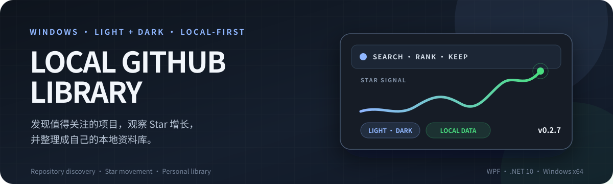
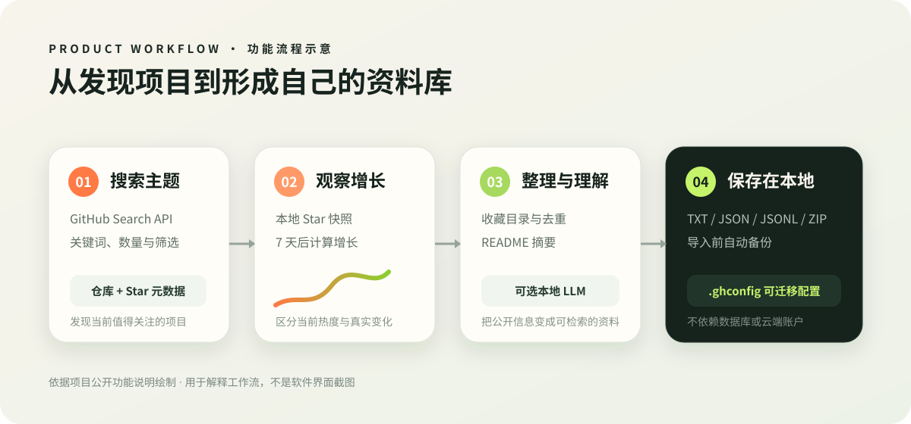
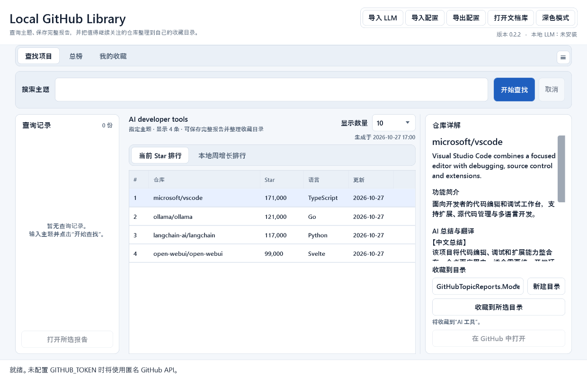
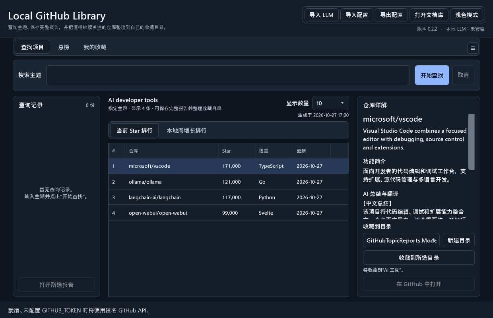
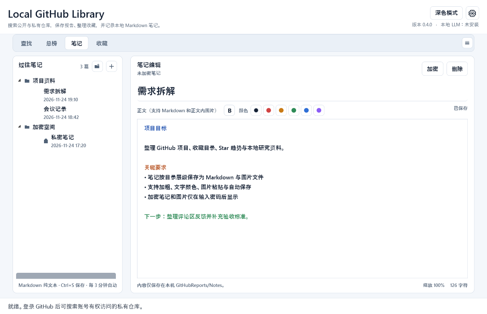

<p align="center">
  
</p>

<h1 align="center">Local GitHub Library</h1>

<p align="center">
  <strong>发现值得关注的项目，观察 Star 增长，并把它们整理成自己的本地资料库。</strong>
</p>

<p align="center">
  
  
  
  
</p>

<p align="center">
  <a href="README.en.md">English</a>
  ·
  <strong>简体中文</strong>
  ·
  <a href="README.zh-TW.md">繁體中文</a>
</p>

<p align="center">
  <a href="https://github.com/huaaorain/local-github-library/releases/latest"><strong>下载最新版本</strong></a>
  ·
  <a href="#user-content-features">核心能力</a>
  ·
  <a href="#user-content-screenshots">界面预览</a>
  ·
  <a href="#user-content-quick-start">快速开始</a>
  ·
  <a href="#user-content-github-login">GitHub 登录</a>
  ·
  <a href="#user-content-releases">所有版本</a>
  ·
  <a href="https://github.com/huaaorain/local-github-library/issues">反馈问题</a>
</p>

---

> [!TIP]
> **适合**需要跨主题发现项目、观察 Star 变化并长期整理仓库的人。
> **不替代** Git 客户端、代码编辑器或 GitHub 网页本身。

## 💡 解决的问题

GitHub 适合找到一个仓库，却不擅长回答跨主题、跨时间的问题：

- 某个技术领域当前 Star 最高的项目有哪些？
- 持续关注的项目，一周或更久以后增长了多少？
- 全站最近一天、一周或一年，哪些项目正在快速上升？
- 如何把搜索结果、收藏和 Star 快照长期保存在自己的电脑上？

**Local GitHub Library** 把这些任务放进一个无需数据库、无需强制云端账户的 Windows 桌面工具中。GitHub 登录是可选项；业务数据继续使用 TXT、JSON、JSONL 和 ZIP 等普通文件，便于查看、备份和迁移。

<a id="features"></a>

## ✨ 核心能力

<table>
  <colgroup>
    <col width="160">
    <col>
  </colgroup>
  <thead>
    <tr>
      <th>模块</th>
      <th>能做什么</th>
    </tr>
  </thead>
  <tbody>
    <tr>
      <td><strong>主&#8239;题&#8239;发&#8239;现</strong></td>
      <td>优先通过 GitHub Topics 定位领域，再用名称与描述补足候选并过滤无关匹配；精确结果不足时可纠正 1–2 个字符的英文拼写错误。点击“仓库”按匹配度排序，点击“Star”严格按数值排序，并可生成 TXT 报告。</td>
    </tr>
    <tr>
      <td><strong>GitHub&#8239;登录</strong></td>
      <td>使用 Fine-grained Personal Access Token 验证 GitHub 账号；登录后可搜索有权限访问的私有仓库，并显示账号状态和退出入口。Token 使用 Windows DPAPI 加密，不会进入报告或配置导出包。</td>
    </tr>
    <tr>
      <td><strong>Star&#8239;趋&#8239;势</strong></td>
      <td>为同一主题保存历史快照；间隔至少 7 天后，可在本地计算 Star 增长排行。</td>
    </tr>
    <tr>
      <td><strong>全&#8239;站&#8239;榜&#8239;单</strong></td>
      <td>查看日、周、月、双月、半年和年的 Star 增量榜，也可单独查看当前 Star 总榜。</td>
    </tr>
    <tr>
      <td><strong>本&#8239;地&#8239;收&#8239;藏</strong></td>
      <td>创建、重命名或删除自定义目录，搜索、批量收藏并跳过重复仓库；可长按目录名调整目录顺序，也可长按仓库名调整项目顺序，列表以缓动动画平滑重排。支持项目备注、备注图标和带时间戳的 TXT 备注导出。</td>
    </tr>
    <tr>
      <td><strong>本&#8239;地&#8239;笔&#8239;记</strong></td>
      <td>使用目录树组织笔记，在 Markdown 正文中插入图片、加粗文字和设置颜色；支持 Ctrl+S、定时自动保存、图片复制、缩放、右键操作和拖动排序。每条笔记保存为同名 Markdown 文件与独立 images 目录；加密笔记的正文和图片都以密文保存，必须输入密码才能查看。</td>
    </tr>
    <tr>
      <td><strong>项&#8239;目&#8239;理&#8239;解</strong></td>
      <td>从 README 提取项目概述；可选本地 LLM 生成中文摘要与翻译，无需云端推理服务。</td>
    </tr>
    <tr>
      <td><strong>数&#8239;据&#8239;迁&#8239;移</strong></td>
      <td>将报告、查询记录、收藏及备注、Star 快照和榜单缓存打包为 `.ghconfig`，导入前自动备份。</td>
    </tr>
    <tr>
      <td><strong>设&#8239;置&#8239;与&#8239;托&#8239;盘</strong></td>
      <td>顶部齿轮集中管理 LLM、配置导入导出、文档库和开机自启；自动记住三个工作区的面板宽度、窗口尺寸和最大化状态，以及各表格的列宽。可自定义全局呼出快捷键（默认 Ctrl+Shift+D），并设置关闭窗口时最小化到托盘或完全退出。浅色与深色主题可随时切换。</td>
    </tr>
  </tbody>
</table>

<sub>\* 可选功能，不登录 GitHub 或不安装本地 LLM 不影响核心搜索、收藏、榜单和报告。</sub>

## 🧩 功能流程



_上图是依据当前源码与公开功能说明绘制的流程示意，不是软件界面截图。_

从 GitHub API 与公开日榜获取数据，在工作台中形成搜索、趋势、收藏和摘要，再把研究记录整理为按目录层级保存的本地 Markdown 笔记。网络数据用于发现，本地笔记、快照与报告负责持续跟踪。

<a id="screenshots"></a>

## 🖼️ 界面预览

| 浅色模式 | 深色模式 |
| --- | --- |
|  |  |



_截图使用非敏感演示数据。笔记页展示目录树、富文本工具栏、本地 Markdown 编辑和加密笔记入口。_

<a id="quick-start"></a>

## 🚀 快速开始

### 1. 下载

| 发布包 | 大小 | 适用场景 |
| --- | ---: | --- |
| [标准版 Windows x64](https://github.com/huaaorain/local-github-library/releases/download/v0.4.1/LocalGithubLibrary-0.4.1-win-x64.zip) | 约 84 MB | 本地笔记、目录排序、GitHub 登录与本地报告 |
| [LLM 模型（可选）](docs/models/README.md) | 约 1.04 GB | 独立下载，升级程序时无需重复下载 |

### 2. 解压并运行

完整解压到有写入权限的普通目录，运行 `GitHubTopicReports.exe`。

> [!IMPORTANT]
> 请保留 EXE 同级的 `runtimes` 目录。不要只移动或复制 EXE 文件。

<a id="github-login"></a>

### 3. \* 登录 GitHub 并搜索私有仓库

匿名 GitHub API 仍可搜索公开仓库。需要提高请求额度或搜索私有仓库时，打开右上角齿轮 `⚙`，进入 **GitHub 账号 → 登录**，粘贴 Personal Access Token 后点击“验证并登录”。

<details>
<summary><strong>创建 Fine-grained Personal Access Token</strong></summary>

1. 打开 [GitHub Fine-grained Token 创建页面](https://github.com/settings/personal-access-tokens/new)。
2. 在 `Token name` 中填写例如 `Local GitHub Library`，并选择 `Expiration` 有效期。
3. `Resource owner` 选择个人账号或需要访问的组织。
4. `Repository access` 选择 `Only select repositories` 并选择需要查询的私有仓库；确需访问全部仓库时才选择 `All repositories`。
5. 在 `Repository permissions` 中把 `Metadata` 设为 `Read-only`，把 `Contents` 设为 `Read-only`。
6. 点击生成，复制以 `github_pat_...` 开头的完整 Token。Token 通常只显示一次。
7. 回到软件设置，把 Token 粘贴到密码框并完成验证。

`Metadata` 用于读取仓库基本信息，`Contents` 用于读取 README 和项目详解。组织可能要求管理员批准 Fine-grained Token。GitHub 官方说明见 [管理 Personal Access Token](https://docs.github.com/authentication/keeping-your-account-and-data-secure/managing-your-personal-access-tokens)。

如果 Fine-grained Token 无法覆盖所需组织，可使用 [Classic Token](https://github.com/settings/tokens/new) 并勾选 `repo`；该权限范围更大，请只在确有需要时使用。

</details>

Token 只通过 GitHub API 使用，并使用 Windows DPAPI 加密保存在当前 Windows 用户下。请勿把 Token 写入报告、Issue 或截图。

## 🧠 \* 本地 LLM

`v0.2.0` 引入可选 `.ghllm` 扩展包。安装后，仓库详情可以流式生成中文翻译和中文总结；未安装时，搜索、排行、收藏与 README 摘要仍可正常使用。

从下一程序版本开始，模型改为独立的 GitHub Pre-release。请从 [LLM 模型库](docs/models/README.md) 下载，程序升级时无需重新下载模型。

<details>
<summary><strong>模型要求与提示词机制</strong></summary>

- 推荐模型：Qwen2.5 1.5B Instruct，Q4_K_M 量化
- 模型大小：约 1.12 GB
- 推荐可用内存：6–8 GB
- 首次加载：约 2–10 秒
- 摘要与翻译：约 8–10 秒
- 推理运行时随主程序发布，不需要 OpenAI API Key

模型包与提示词分开管理。提示词可导入、编辑、保存和导出，并支持：

```text
{{FullName}}      # 必填
{{Description}}
{{Topics}}
{{ReadmeSummary}}
```

模型下载入口见 [LLM 模型库](docs/models/README.md)，完整打包与校验规则见 [docs/LLM_PACKAGE.md](docs/LLM_PACKAGE.md)。导入模型和提示词时，请打开顶部齿轮中的“导入 LLM”。

</details>

## 🛡️ 数据与隐私

程序在 EXE 旁维护 `GitHubReports/`：

```text
GitHubReports/
  Reports/               # 主题、收藏与总榜报告
  Data/
    搜索记录.txt
    star-snapshots.jsonl
    favorites.json
    app-settings.json
    github-auth.bin       # DPAPI 加密的 GitHub 登录凭据
    global-daily-ranks.zip
    error.log
  Backups/               # 导入配置前自动生成
  LLM/
    Packages/            # 可选本地模型
    prompt.txt
  Notes/                 # 目录化本地笔记
    项目资料/
      需求拆解/
        需求拆解.md
        images/
    加密空间/
      私密笔记/
        私密笔记.md.enc
        images/
          *.png.enc
```

- GitHub Token 通过软件设置登录，并加密保存在 `github-auth.bin`；高级用户仍可使用 `GITHUB_TOKEN` 或 `github-token.txt`。
- `.ghconfig` 不导出 Token、GitHub 登录凭据和错误日志。
- 导入前自动备份，并校验格式、体积与路径安全。
- 报告、收藏和 Star 快照不会上传到第三方分析或推理服务。

<a id="releases"></a>

## 📦 所有版本

<!-- release-catalog:start -->
最新版本: [Local GitHub Library v0.4.1](https://github.com/huaaorain/local-github-library/releases/tag/v0.4.1)

| 版本 | 发布时间 | 发布说明 |
| --- | --- | --- |
| `v0.4.1` | 2026-11-27 | [打开](https://github.com/huaaorain/local-github-library/releases/tag/v0.4.1) |
| `v0.4.0` | 2026-11-24 | [打开](https://github.com/huaaorain/local-github-library/releases/tag/v0.4.0) |
| `v0.3.1` | 2026-11-23 | [打开](https://github.com/huaaorain/local-github-library/releases/tag/v0.3.1) |
| `v0.3.0` | 2026-11-20 | [打开](https://github.com/huaaorain/local-github-library/releases/tag/v0.3.0) |
| `v0.2.7` | 2026-11-19 | [打开](https://github.com/huaaorain/local-github-library/releases/tag/v0.2.7) |
| `v0.2.6` | 2026-11-06 | [打开](https://github.com/huaaorain/local-github-library/releases/tag/v0.2.6) |
| `v0.2.5` | 2026-11-06 | [打开](https://github.com/huaaorain/local-github-library/releases/tag/v0.2.5) |
| `v0.2.4` | 2026-11-05 | [打开](https://github.com/huaaorain/local-github-library/releases/tag/v0.2.4) |
| `models-qwen2.5-1.5b-v1` | 2026-11-05 | [打开](https://github.com/huaaorain/local-github-library/releases/tag/models-qwen2.5-1.5b-v1) |
| `v0.2.3` | 2026-11-04 | [打开](https://github.com/huaaorain/local-github-library/releases/tag/v0.2.3) |
| `v0.2.2` | 2026-11-02 | [打开](https://github.com/huaaorain/local-github-library/releases/tag/v0.2.2) |
| `v0.2.1` | 2026-10-27 | [打开](https://github.com/huaaorain/local-github-library/releases/tag/v0.2.1) |
| `v0.2.0` | 2026-10-26 | [打开](https://github.com/huaaorain/local-github-library/releases/tag/v0.2.0) |
| `v0.1.0` | 2026-10-26 | [打开](https://github.com/huaaorain/local-github-library/releases/tag/v0.1.0) |

<details>
<summary><strong>全部版本下载</strong></summary>

### Local GitHub Library v0.4.1

发布说明: [打开](https://github.com/huaaorain/local-github-library/releases/tag/v0.4.1)

- [FILE_MANIFEST.md](https://github.com/huaaorain/local-github-library/releases/download/v0.4.1/FILE_MANIFEST.md) — 859 B
- [GitHubTopicReports.exe](https://github.com/huaaorain/local-github-library/releases/download/v0.4.1/GitHubTopicReports.exe) — 81.3 MB
- [LICENSE](https://github.com/huaaorain/local-github-library/releases/download/v0.4.1/LICENSE) — 4.5 KB
- [LocalGithubLibrary-0.4.1-win-x64.zip](https://github.com/huaaorain/local-github-library/releases/download/v0.4.1/LocalGithubLibrary-0.4.1-win-x64.zip) — 83.3 MB
- [release-manifest.json](https://github.com/huaaorain/local-github-library/releases/download/v0.4.1/release-manifest.json) — 2.4 KB
- [SHA256SUMS.txt](https://github.com/huaaorain/local-github-library/releases/download/v0.4.1/SHA256SUMS.txt) — 266 B
- [源代码（zip）](https://github.com/huaaorain/local-github-library/archive/refs/tags/v0.4.1.zip)
- [源代码（tar.gz）](https://github.com/huaaorain/local-github-library/archive/refs/tags/v0.4.1.tar.gz)

### Local GitHub Library v0.4.0

发布说明: [打开](https://github.com/huaaorain/local-github-library/releases/tag/v0.4.0)

- [FILE_MANIFEST.md](https://github.com/huaaorain/local-github-library/releases/download/v0.4.0/FILE_MANIFEST.md) — 696 B
- [GitHubTopicReports.exe](https://github.com/huaaorain/local-github-library/releases/download/v0.4.0/GitHubTopicReports.exe) — 81.3 MB
- [LocalGithubLibrary-0.4.0-win-x64.zip](https://github.com/huaaorain/local-github-library/releases/download/v0.4.0/LocalGithubLibrary-0.4.0-win-x64.zip) — 83.3 MB
- [release-manifest.json](https://github.com/huaaorain/local-github-library/releases/download/v0.4.0/release-manifest.json) — 1.8 KB
- [SHA256SUMS.txt](https://github.com/huaaorain/local-github-library/releases/download/v0.4.0/SHA256SUMS.txt) — 192 B
- [源代码（zip）](https://github.com/huaaorain/local-github-library/archive/refs/tags/v0.4.0.zip)
- [源代码（tar.gz）](https://github.com/huaaorain/local-github-library/archive/refs/tags/v0.4.0.tar.gz)

### Local GitHub Library v0.3.1

发布说明: [打开](https://github.com/huaaorain/local-github-library/releases/tag/v0.3.1)

- [FILE_MANIFEST.md](https://github.com/huaaorain/local-github-library/releases/download/v0.3.1/FILE_MANIFEST.md) — 683 B
- [GitHubTopicReports.exe](https://github.com/huaaorain/local-github-library/releases/download/v0.3.1/GitHubTopicReports.exe) — 81.3 MB
- [LocalGithubLibrary-0.3.1-win-x64.zip](https://github.com/huaaorain/local-github-library/releases/download/v0.3.1/LocalGithubLibrary-0.3.1-win-x64.zip) — 83.6 MB
- [release-manifest.json](https://github.com/huaaorain/local-github-library/releases/download/v0.3.1/release-manifest.json) — 1.8 KB
- [SHA256SUMS.txt](https://github.com/huaaorain/local-github-library/releases/download/v0.3.1/SHA256SUMS.txt) — 192 B
- [源代码（zip）](https://github.com/huaaorain/local-github-library/archive/refs/tags/v0.3.1.zip)
- [源代码（tar.gz）](https://github.com/huaaorain/local-github-library/archive/refs/tags/v0.3.1.tar.gz)

### Local GitHub Library v0.3.0

发布说明: [打开](https://github.com/huaaorain/local-github-library/releases/tag/v0.3.0)

- [FILE_MANIFEST.md](https://github.com/huaaorain/local-github-library/releases/download/v0.3.0/FILE_MANIFEST.md) — 683 B
- [GitHubTopicReports.exe](https://github.com/huaaorain/local-github-library/releases/download/v0.3.0/GitHubTopicReports.exe) — 81.3 MB
- [LocalGithubLibrary-0.3.0-win-x64.zip](https://github.com/huaaorain/local-github-library/releases/download/v0.3.0/LocalGithubLibrary-0.3.0-win-x64.zip) — 83.6 MB
- [release-manifest.json](https://github.com/huaaorain/local-github-library/releases/download/v0.3.0/release-manifest.json) — 1.8 KB
- [SHA256SUMS.txt](https://github.com/huaaorain/local-github-library/releases/download/v0.3.0/SHA256SUMS.txt) — 192 B
- [源代码（zip）](https://github.com/huaaorain/local-github-library/archive/refs/tags/v0.3.0.zip)
- [源代码（tar.gz）](https://github.com/huaaorain/local-github-library/archive/refs/tags/v0.3.0.tar.gz)

### Local GitHub Library 0.2.7

发布说明: [打开](https://github.com/huaaorain/local-github-library/releases/tag/v0.2.7)

- [FILE_MANIFEST.md](https://github.com/huaaorain/local-github-library/releases/download/v0.2.7/FILE_MANIFEST.md) — 695 B
- [GitHubTopicReports.exe](https://github.com/huaaorain/local-github-library/releases/download/v0.2.7/GitHubTopicReports.exe) — 81.3 MB
- [LocalGithubLibrary-0.2.7-win-x64.zip](https://github.com/huaaorain/local-github-library/releases/download/v0.2.7/LocalGithubLibrary-0.2.7-win-x64.zip) — 83.6 MB
- [release-manifest.json](https://github.com/huaaorain/local-github-library/releases/download/v0.2.7/release-manifest.json) — 1.8 KB
- [SHA256SUMS.txt](https://github.com/huaaorain/local-github-library/releases/download/v0.2.7/SHA256SUMS.txt) — 192 B
- [源代码（zip）](https://github.com/huaaorain/local-github-library/archive/refs/tags/v0.2.7.zip)
- [源代码（tar.gz）](https://github.com/huaaorain/local-github-library/archive/refs/tags/v0.2.7.tar.gz)

### Local GitHub Library 0.2.6

发布说明: [打开](https://github.com/huaaorain/local-github-library/releases/tag/v0.2.6)

- [FILE_MANIFEST.md](https://github.com/huaaorain/local-github-library/releases/download/v0.2.6/FILE_MANIFEST.md) — 695 B
- [GitHubTopicReports.exe](https://github.com/huaaorain/local-github-library/releases/download/v0.2.6/GitHubTopicReports.exe) — 81.2 MB
- [LocalGithubLibrary-0.2.6-win-x64.zip](https://github.com/huaaorain/local-github-library/releases/download/v0.2.6/LocalGithubLibrary-0.2.6-win-x64.zip) — 83.6 MB
- [release-manifest.json](https://github.com/huaaorain/local-github-library/releases/download/v0.2.6/release-manifest.json) — 1.8 KB
- [SHA256SUMS.txt](https://github.com/huaaorain/local-github-library/releases/download/v0.2.6/SHA256SUMS.txt) — 192 B
- [源代码（zip）](https://github.com/huaaorain/local-github-library/archive/refs/tags/v0.2.6.zip)
- [源代码（tar.gz）](https://github.com/huaaorain/local-github-library/archive/refs/tags/v0.2.6.tar.gz)

### Local GitHub Library 0.2.5

发布说明: [打开](https://github.com/huaaorain/local-github-library/releases/tag/v0.2.5)

- [FILE_MANIFEST.md](https://github.com/huaaorain/local-github-library/releases/download/v0.2.5/FILE_MANIFEST.md) — 695 B
- [GitHubTopicReports.exe](https://github.com/huaaorain/local-github-library/releases/download/v0.2.5/GitHubTopicReports.exe) — 80.7 MB
- [LocalGithubLibrary-0.2.5-win-x64.zip](https://github.com/huaaorain/local-github-library/releases/download/v0.2.5/LocalGithubLibrary-0.2.5-win-x64.zip) — 83.0 MB
- [release-manifest.json](https://github.com/huaaorain/local-github-library/releases/download/v0.2.5/release-manifest.json) — 1.8 KB
- [SHA256SUMS.txt](https://github.com/huaaorain/local-github-library/releases/download/v0.2.5/SHA256SUMS.txt) — 192 B
- [源代码（zip）](https://github.com/huaaorain/local-github-library/archive/refs/tags/v0.2.5.zip)
- [源代码（tar.gz）](https://github.com/huaaorain/local-github-library/archive/refs/tags/v0.2.5.tar.gz)

### Local GitHub Library 0.2.4

发布说明: [打开](https://github.com/huaaorain/local-github-library/releases/tag/v0.2.4)

- [FILE_MANIFEST.md](https://github.com/huaaorain/local-github-library/releases/download/v0.2.4/FILE_MANIFEST.md) — 695 B
- [GitHubTopicReports.exe](https://github.com/huaaorain/local-github-library/releases/download/v0.2.4/GitHubTopicReports.exe) — 70.6 MB
- [LocalGithubLibrary-0.2.4-win-x64.zip](https://github.com/huaaorain/local-github-library/releases/download/v0.2.4/LocalGithubLibrary-0.2.4-win-x64.zip) — 73.1 MB
- [release-manifest.json](https://github.com/huaaorain/local-github-library/releases/download/v0.2.4/release-manifest.json) — 1.8 KB
- [SHA256SUMS.txt](https://github.com/huaaorain/local-github-library/releases/download/v0.2.4/SHA256SUMS.txt) — 192 B
- [源代码（zip）](https://github.com/huaaorain/local-github-library/archive/refs/tags/v0.2.4.zip)
- [源代码（tar.gz）](https://github.com/huaaorain/local-github-library/archive/refs/tags/v0.2.4.tar.gz)

### LLM 模型库 - Qwen2.5 1.5B Q4_K_M v1

发布说明: [打开](https://github.com/huaaorain/local-github-library/releases/tag/models-qwen2.5-1.5b-v1)

- [FILE_MANIFEST.md](https://github.com/huaaorain/local-github-library/releases/download/models-qwen2.5-1.5b-v1/FILE_MANIFEST.md) — 516 B
- [Qwen2.5-1.5B-Instruct-Q4_K_M.ghllm](https://github.com/huaaorain/local-github-library/releases/download/models-qwen2.5-1.5b-v1/Qwen2.5-1.5B-Instruct-Q4_K_M.ghllm) — 1.0 GB
- [release-manifest.json](https://github.com/huaaorain/local-github-library/releases/download/models-qwen2.5-1.5b-v1/release-manifest.json) — 1.1 KB
- [SHA256SUMS.txt](https://github.com/huaaorain/local-github-library/releases/download/models-qwen2.5-1.5b-v1/SHA256SUMS.txt) — 101 B
- [源代码（zip）](https://github.com/huaaorain/local-github-library/archive/refs/tags/models-qwen2.5-1.5b-v1.zip)
- [源代码（tar.gz）](https://github.com/huaaorain/local-github-library/archive/refs/tags/models-qwen2.5-1.5b-v1.tar.gz)

### Local GitHub Library 0.2.3

发布说明: [打开](https://github.com/huaaorain/local-github-library/releases/tag/v0.2.3)

- [FILE_MANIFEST.md](https://github.com/huaaorain/local-github-library/releases/download/v0.2.3/FILE_MANIFEST.md) — 1.0 KB
- [GitHubTopicReports.exe](https://github.com/huaaorain/local-github-library/releases/download/v0.2.3/GitHubTopicReports.exe) — 70.6 MB
- [LocalGithubLibrary-0.2.3-full-win-x64.zip](https://github.com/huaaorain/local-github-library/releases/download/v0.2.3/LocalGithubLibrary-0.2.3-full-win-x64.zip) — 1.1 GB
- [LocalGithubLibrary-0.2.3-win-x64.zip](https://github.com/huaaorain/local-github-library/releases/download/v0.2.3/LocalGithubLibrary-0.2.3-win-x64.zip) — 73.0 MB
- [Qwen2.5-1.5B-Instruct-Q4_K_M.ghllm](https://github.com/huaaorain/local-github-library/releases/download/v0.2.3/Qwen2.5-1.5B-Instruct-Q4_K_M.ghllm) — 1.0 GB
- [release-manifest.json](https://github.com/huaaorain/local-github-library/releases/download/v0.2.3/release-manifest.json) — 3.1 KB
- [SHA256SUMS.txt](https://github.com/huaaorain/local-github-library/releases/download/v0.2.3/SHA256SUMS.txt) — 401 B
- [源代码（zip）](https://github.com/huaaorain/local-github-library/archive/refs/tags/v0.2.3.zip)
- [源代码（tar.gz）](https://github.com/huaaorain/local-github-library/archive/refs/tags/v0.2.3.tar.gz)

### Local GitHub Library 0.2.2

发布说明: [打开](https://github.com/huaaorain/local-github-library/releases/tag/v0.2.2)

- [FILE_MANIFEST.md](https://github.com/huaaorain/local-github-library/releases/download/v0.2.2/FILE_MANIFEST.md) — 1.0 KB
- [GitHubTopicReports.exe](https://github.com/huaaorain/local-github-library/releases/download/v0.2.2/GitHubTopicReports.exe) — 70.6 MB
- [LocalGithubLibrary-0.2.2-full-win-x64.zip](https://github.com/huaaorain/local-github-library/releases/download/v0.2.2/LocalGithubLibrary-0.2.2-full-win-x64.zip) — 1.1 GB
- [LocalGithubLibrary-0.2.2-win-x64.zip](https://github.com/huaaorain/local-github-library/releases/download/v0.2.2/LocalGithubLibrary-0.2.2-win-x64.zip) — 72.8 MB
- [Qwen2.5-1.5B-Instruct-Q4_K_M.ghllm](https://github.com/huaaorain/local-github-library/releases/download/v0.2.2/Qwen2.5-1.5B-Instruct-Q4_K_M.ghllm) — 1.0 GB
- [release-manifest.json](https://github.com/huaaorain/local-github-library/releases/download/v0.2.2/release-manifest.json) — 2.0 KB
- [SHA256SUMS.txt](https://github.com/huaaorain/local-github-library/releases/download/v0.2.2/SHA256SUMS.txt) — 401 B
- [源代码（zip）](https://github.com/huaaorain/local-github-library/archive/refs/tags/v0.2.2.zip)
- [源代码（tar.gz）](https://github.com/huaaorain/local-github-library/archive/refs/tags/v0.2.2.tar.gz)

### Local GitHub Library 0.2.1

发布说明: [打开](https://github.com/huaaorain/local-github-library/releases/tag/v0.2.1)

- [FILE_MANIFEST.md](https://github.com/huaaorain/local-github-library/releases/download/v0.2.1/FILE_MANIFEST.md) — 1.0 KB
- [GitHubTopicReports.exe](https://github.com/huaaorain/local-github-library/releases/download/v0.2.1/GitHubTopicReports.exe) — 70.6 MB
- [LocalGithubLibrary-0.2.1-full-win-x64.zip](https://github.com/huaaorain/local-github-library/releases/download/v0.2.1/LocalGithubLibrary-0.2.1-full-win-x64.zip) — 1.1 GB
- [LocalGithubLibrary-0.2.1-win-x64.zip](https://github.com/huaaorain/local-github-library/releases/download/v0.2.1/LocalGithubLibrary-0.2.1-win-x64.zip) — 72.8 MB
- [Qwen2.5-1.5B-Instruct-Q4_K_M.ghllm](https://github.com/huaaorain/local-github-library/releases/download/v0.2.1/Qwen2.5-1.5B-Instruct-Q4_K_M.ghllm) — 1.0 GB
- [release-manifest.json](https://github.com/huaaorain/local-github-library/releases/download/v0.2.1/release-manifest.json) — 2.0 KB
- [SHA256SUMS.txt](https://github.com/huaaorain/local-github-library/releases/download/v0.2.1/SHA256SUMS.txt) — 401 B
- [源代码（zip）](https://github.com/huaaorain/local-github-library/archive/refs/tags/v0.2.1.zip)
- [源代码（tar.gz）](https://github.com/huaaorain/local-github-library/archive/refs/tags/v0.2.1.tar.gz)

### Local GitHub Library 0.2.0

发布说明: [打开](https://github.com/huaaorain/local-github-library/releases/tag/v0.2.0)

- [GitHubTopicReports.exe](https://github.com/huaaorain/local-github-library/releases/download/v0.2.0/GitHubTopicReports.exe) — 70.6 MB
- [LocalGithubLibrary-0.2.0-full-win-x64.zip](https://github.com/huaaorain/local-github-library/releases/download/v0.2.0/LocalGithubLibrary-0.2.0-full-win-x64.zip) — 1.1 GB
- [LocalGithubLibrary-0.2.0-source.zip](https://github.com/huaaorain/local-github-library/releases/download/v0.2.0/LocalGithubLibrary-0.2.0-source.zip) — 75.3 KB
- [LocalGithubLibrary-0.2.0-win-x64.zip](https://github.com/huaaorain/local-github-library/releases/download/v0.2.0/LocalGithubLibrary-0.2.0-win-x64.zip) — 73.2 MB
- [Qwen2.5-1.5B-Instruct-Q4_K_M.ghllm](https://github.com/huaaorain/local-github-library/releases/download/v0.2.0/Qwen2.5-1.5B-Instruct-Q4_K_M.ghllm) — 1.0 GB
- [RELEASE_NOTES_0.2.0.md](https://github.com/huaaorain/local-github-library/releases/download/v0.2.0/RELEASE_NOTES_0.2.0.md) — 3.1 KB
- [SHA256SUMS.txt](https://github.com/huaaorain/local-github-library/releases/download/v0.2.0/SHA256SUMS.txt) — 598 B
- [源代码（zip）](https://github.com/huaaorain/local-github-library/archive/refs/tags/v0.2.0.zip)
- [源代码（tar.gz）](https://github.com/huaaorain/local-github-library/archive/refs/tags/v0.2.0.tar.gz)

### Local GitHub Library 0.1.0

发布说明: [打开](https://github.com/huaaorain/local-github-library/releases/tag/v0.1.0)

- [GitHubTopicReports-v0.1.0-win-x64.exe](https://github.com/huaaorain/local-github-library/releases/download/v0.1.0/GitHubTopicReports-v0.1.0-win-x64.exe) — 61.9 MB
- [源代码（zip）](https://github.com/huaaorain/local-github-library/archive/refs/tags/v0.1.0.zip)
- [源代码（tar.gz）](https://github.com/huaaorain/local-github-library/archive/refs/tags/v0.1.0.tar.gz)

</details>
<!-- release-catalog:end -->

## 🖥️ 系统要求

- Windows 10 或 Windows 11，64 位
- Intel 或 AMD 处理器
- 可访问 `github.com` 与 `api.github.com`
- 搜索、README 读取与当前榜单需要联网
- 收藏浏览和已下载的榜单缓存可离线使用
- 笔记编辑、图片管理、加密笔记和已保存笔记浏览可离线使用

## ⚠️ 已知限制

- GitHub Search API 最多返回 1000 条结果，匿名请求额度较低。
- 登录后的私有仓库补充匹配覆盖最近更新的最多 1,000 个可访问仓库。
- 全站增量榜依赖 [OpenGithubs 公开日榜](https://github.com/OpenGithubs/github-daily-rank) 的覆盖范围。
- 当前只提供 Windows x64 构建。
- 未签名 EXE 可能触发 Windows SmartScreen 提示。
- 加密笔记会加密正文和图片内容；标题、目录名和文件数量仍可能从本地路径看出。忘记密码后无法恢复正文。
- 从 0.3.x 升级时旧笔记会自动迁移；旧加密笔记需要先解锁并保存，才能把占位目录改成真实笔记名称。
- 本项目采用 PolyForm Noncommercial 1.0.0，仅允许非商业用途；它不是 OSI 开源许可证。商业用途需要单独授权。

## 🔧 从源码构建

<details>
<summary><strong>构建、运行与发布</strong></summary>

```powershell
dotnet restore
dotnet build .\GitHubTopicReports.csproj -c Release
dotnet run --project .\GitHubTopicReports.csproj
```

发布 Windows x64 自包含版本：

```powershell
.\publish.ps1
```

发布脚本会生成单文件主程序，并将 LLamaSharp 的 CPU 原生运行库复制到 `dist\runtimes\win-x64\native`。分发时必须包含该目录。

</details>

## 🤝 参与贡献

欢迎提交 Issue 和 Pull Request。提交前请确认：

- 不包含 Token、个人报告、收藏或本地日志。
- 已完成 Release 构建。
- 修改配置格式时同步升级 `formatVersion`。

## 📝 更新记录

- [0.4.1：自定义全局呼出快捷键、保存表格列宽与启动修复](docs/releases/v0.4.1.zh-CN.md)
- [0.4.0：目录化本地笔记、丰富编辑、加密图片与安全写入](docs/releases/v0.4.0.zh-CN.md)
- [0.3.1：收藏目录拖动排序与重启布局恢复](docs/releases/v0.3.1.zh-CN.md)
- [0.3.0：GitHub 登录、私有仓库搜索与安全凭据存储](docs/releases/v0.3.0.zh-CN.md)
- [0.2.7：收藏拖动排序、备注标识、开机自启与目录默认页](docs/releases/v0.2.7.zh-CN.md)
- [0.2.6：拼写容错搜索与多分辨率应用图标](docs/releases/v0.2.6.zh-CN.md)
- [0.2.5：软件设置、系统托盘与可配置关闭行为](docs/releases/v0.2.5.zh-CN.md)
- [0.2.4：收藏备注、目录管理图标与独立模型发布](docs/releases/v0.2.4.zh-CN.md)
- [0.2.3：应用级设计系统、深浅色主题与交互状态重做](docs/releases/v0.2.3.zh-CN.md)
- [0.2.2：跨领域搜索相关性、数值排序与结果稳定性修复](docs/releases/v0.2.2.md)
- [0.2.1：可调面板布局、恢复布局按钮与界面细节优化](docs/releases/v0.2.1.md)
- [0.2.0：本地 LLM、提示词管理与收藏体验修复](docs/releases/v0.2.0.md)
- [0.1.0：首个公开版本](docs/releases/v0.1.0.md)
- 完整历史见 [CHANGELOG.md](CHANGELOG.md)

## 🙏 致谢

- [GitHub REST API](https://docs.github.com/rest)
- [OpenGithubs GitHub Daily Rank](https://github.com/OpenGithubs/github-daily-rank)
- [.NET](https://dotnet.microsoft.com/) 与 WPF
- [LLamaSharp](https://github.com/SciSharp/LLamaSharp) 与 [llama.cpp](https://github.com/ggml-org/llama.cpp)
- Qwen2.5 模型（Apache-2.0）

## 📄 License

本项目采用 PolyForm Noncommercial 1.0.0，仅允许非商业用途；它不是 OSI 开源许可证。商业用途需要单独授权。完整条款见 [LICENSE](LICENSE)。
