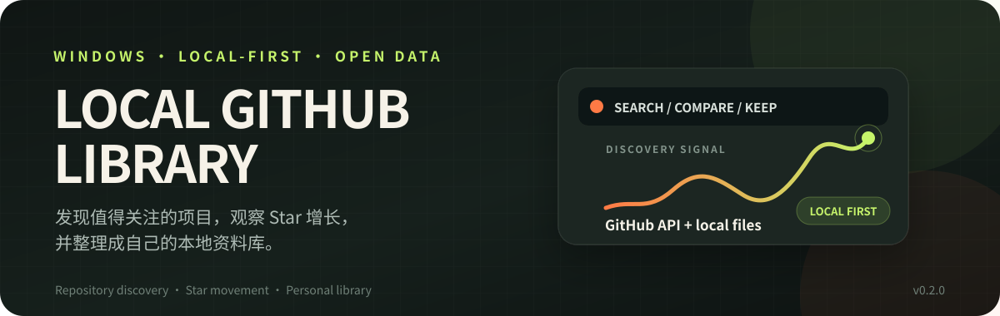
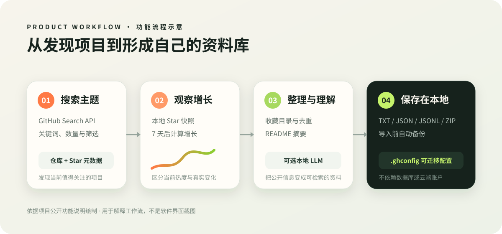

<p align="center">
  
</p>

<h1 align="center">Local GitHub Library</h1>

<p align="center">
  <strong>發現值得關注的專案，觀察 Star 成長，並整理成自己的本機資料庫。</strong>
</p>

<p align="center">
  
  
  
  
</p>

<p align="center">
  <a href="README.en.md">English</a>
  ·
  <a href="README.md">简体中文</a>
  ·
  <strong>繁體中文</strong>
</p>

<p align="center">
  <a href="https://github.com/huaaorain/local-github-library/releases/latest"><strong>下載最新版本</strong></a>
  ·
  <a href="#核心能力">核心能力</a>
  ·
  <a href="#快速開始">快速開始</a>
  ·
  <a href="#所有版本">所有版本</a>
  ·
  <a href="https://github.com/huaaorain/local-github-library/issues">回報問題</a>
</p>

---

## 解決的問題

GitHub 適合找到一個倉庫，卻不擅長回答跨主題、跨時間的問題：

- 某個技術領域目前 Star 最高的專案有哪些？
- 持續關注的專案，一週或更久之後成長了多少？
- 全站最近一天、一週或一年，哪些專案正在快速上升？
- 如何把搜尋結果、收藏和 Star 快照長期保存在自己的電腦上？

**Local GitHub Library** 把這些任務放進一個不需要資料庫、不需要雲端帳戶的 Windows 桌面工具。業務資料使用 TXT、JSON、JSONL 和 ZIP 等一般檔案，便於查看、備份和移轉。

## 核心能力

<table>
  <colgroup>
    <col width="160">
    <col>
  </colgroup>
  <thead>
    <tr>
      <th>模組</th>
      <th>功能說明</th>
    </tr>
  </thead>
  <tbody>
    <tr>
      <td><strong>主&#8239;題&#8239;搜&#8239;尋</strong></td>
      <td>依關鍵字搜尋 GitHub 倉庫，查看 Star、Fork、Issues、語言、License、Topics 與更新時間，並產生可閱讀的 TXT 報告。</td>
    </tr>
    <tr>
      <td><strong>Star&#8239;趨&#8239;勢</strong></td>
      <td>為同一主題保存歷史快照；間隔至少 7 天後，可在本機計算 Star 成長排行。</td>
    </tr>
    <tr>
      <td><strong>全&#8239;站&#8239;排&#8239;行</strong></td>
      <td>查看日、週、月、雙月、半年和一年的 Star 增量榜，也可單獨查看目前 Star 總榜。</td>
    </tr>
    <tr>
      <td><strong>本&#8239;機&#8239;收&#8239;藏</strong></td>
      <td>建立自訂目錄、搜尋、批次收藏並跳過重複倉庫，把專案長期整理成個人資料庫。</td>
    </tr>
    <tr>
      <td><strong>專&#8239;案&#8239;理&#8239;解</strong></td>
      <td>從 README 擷取專案概述；可選本機 LLM 產生中文摘要與翻譯，不需要雲端推理服務。</td>
    </tr>
    <tr>
      <td><strong>資&#8239;料&#8239;移&#8239;轉</strong></td>
      <td>將報告、查詢記錄、收藏、Star 快照和榜單快取打包為 `.ghconfig`，匯入前自動備份。</td>
    </tr>
  </tbody>
</table>

## 功能流程



_上圖是依據目前原始碼與公開功能說明繪製的流程示意，不是軟體介面截圖。_

從 GitHub API 與公開日榜取得資料，在工作台中形成搜尋、趨勢、收藏和摘要，再保存為本機檔案。網路資料用於發現，本機快照與報告負責持續追蹤。

## 快速開始

### 1. 下載

| 發佈包 | 大小 | 適用情境 |
| --- | ---: | --- |
| [標準版 Windows x64](https://github.com/huaaorain/local-github-library/releases/download/v0.2.0/LocalGithubLibrary-0.2.0-win-x64.zip) | 約 77 MB | 搜尋、排行、收藏與 README 摘要 |
| [完整離線版](https://github.com/huaaorain/local-github-library/releases/download/v0.2.0/LocalGithubLibrary-0.2.0-full-win-x64.zip) | 約 1.21 GB | 額外包含 Qwen2.5 1.5B 本機模型 |

### 2. 解壓縮並執行

完整解壓縮到具有寫入權限的一般目錄，執行 `GitHubTopicReports.exe`。

> [!IMPORTANT]
> 請保留 EXE 同層的 `runtimes` 目錄。不要只移動或複製 EXE 檔案。

### 3. 視需要設定 GitHub Token

匿名 GitHub API 可用，但額度較低。需要更穩定的搜尋和榜單更新時，在 EXE 旁建立 `github-token.txt`，檔案內只填寫唯讀 Token。

```powershell
# 也可以使用環境變數
$env:GITHUB_TOKEN = "your_token"
```

請勿提交或分享 Token。

## 本機 LLM

`v0.2.0` 加入可選 `.ghllm` 擴充包。安裝後，倉庫詳情可以串流產生中文翻譯和摘要；未安裝時，搜尋、排行、收藏與 README 摘要仍可正常使用。

<details>
<summary><strong>模型需求與提示詞機制</strong></summary>

- 建議模型：Qwen2.5 1.5B Instruct，Q4_K_M 量化
- 模型大小：約 1.12 GB
- 建議可用記憶體：6–8 GB
- 首次載入：約 2–10 秒
- 摘要與翻譯：約 8–10 秒
- 推理執行環境隨主程式發佈，不需要 OpenAI API Key

模型包與提示詞分開管理。提示詞可匯入、編輯、保存和匯出，並支援：

```text
{{FullName}}      # 必填
{{Description}}
{{Topics}}
{{ReadmeSummary}}
```

完整打包與驗證規則見 [docs/LLM_PACKAGE.md](docs/LLM_PACKAGE.md)。

</details>

## 資料與隱私

程式在 EXE 旁維護 `GitHubReports/`：

```text
GitHubReports/
  Reports/               # 主題、收藏與總榜報告
  Data/
    搜索记录.txt
    star-snapshots.jsonl
    favorites.json
    global-daily-ranks.zip
    error.log
  Backups/               # 匯入設定前自動產生
  LLM/
    Packages/            # 可選本機模型
    prompt.txt
```

- GitHub Token 只從環境變數或 `github-token.txt` 讀取。
- `.ghconfig` 不匯出 Token 和錯誤記錄。
- 匯入前自動備份，並驗證格式、大小與路徑安全。
- 報告、收藏和 Star 快照不會上傳到第三方分析或推理服務。

## 所有版本

<!-- release-catalog:start -->
最新版本: [Local GitHub Library 0.2.0](https://github.com/huaaorain/local-github-library/releases/tag/v0.2.0)

| 版本 | 發佈時間 | 發佈說明 |
| --- | --- | --- |
| `v0.2.0` | 2026-10-26 | [開啟](https://github.com/huaaorain/local-github-library/releases/tag/v0.2.0) |
| `v0.1.0` | 2026-10-26 | [開啟](https://github.com/huaaorain/local-github-library/releases/tag/v0.1.0) |

<details>
<summary><strong>全部版本下載</strong></summary>

### Local GitHub Library 0.2.0

發佈說明: [開啟](https://github.com/huaaorain/local-github-library/releases/tag/v0.2.0)

- [GitHubTopicReports.exe](https://github.com/huaaorain/local-github-library/releases/download/v0.2.0/GitHubTopicReports.exe) — 70.6 MB
- [LocalGithubLibrary-0.2.0-full-win-x64.zip](https://github.com/huaaorain/local-github-library/releases/download/v0.2.0/LocalGithubLibrary-0.2.0-full-win-x64.zip) — 1.1 GB
- [LocalGithubLibrary-0.2.0-source.zip](https://github.com/huaaorain/local-github-library/releases/download/v0.2.0/LocalGithubLibrary-0.2.0-source.zip) — 75.3 KB
- [LocalGithubLibrary-0.2.0-win-x64.zip](https://github.com/huaaorain/local-github-library/releases/download/v0.2.0/LocalGithubLibrary-0.2.0-win-x64.zip) — 73.2 MB
- [Qwen2.5-1.5B-Instruct-Q4_K_M.ghllm](https://github.com/huaaorain/local-github-library/releases/download/v0.2.0/Qwen2.5-1.5B-Instruct-Q4_K_M.ghllm) — 1.0 GB
- [RELEASE_NOTES_0.2.0.md](https://github.com/huaaorain/local-github-library/releases/download/v0.2.0/RELEASE_NOTES_0.2.0.md) — 3.1 KB
- [SHA256SUMS.txt](https://github.com/huaaorain/local-github-library/releases/download/v0.2.0/SHA256SUMS.txt) — 598 B
- [原始碼（zip）](https://github.com/huaaorain/local-github-library/archive/refs/tags/v0.2.0.zip)
- [原始碼（tar.gz）](https://github.com/huaaorain/local-github-library/archive/refs/tags/v0.2.0.tar.gz)

### Local GitHub Library 0.1.0

發佈說明: [開啟](https://github.com/huaaorain/local-github-library/releases/tag/v0.1.0)

- [GitHubTopicReports-v0.1.0-win-x64.exe](https://github.com/huaaorain/local-github-library/releases/download/v0.1.0/GitHubTopicReports-v0.1.0-win-x64.exe) — 61.9 MB
- [原始碼（zip）](https://github.com/huaaorain/local-github-library/archive/refs/tags/v0.1.0.zip)
- [原始碼（tar.gz）](https://github.com/huaaorain/local-github-library/archive/refs/tags/v0.1.0.tar.gz)

</details>
<!-- release-catalog:end -->

## 系統需求

- Windows 10 或 Windows 11，64 位元
- Intel 或 AMD 處理器
- 可存取 `github.com` 與 `api.github.com`
- 搜尋、README 讀取與目前榜單需要網路
- 收藏瀏覽和已下載的榜單快取可離線使用

## 已知限制

- GitHub Search API 最多回傳 1000 筆結果，匿名請求額度較低。
- 全站增量榜依賴 [OpenGithubs 公開日榜](https://github.com/OpenGithubs/github-daily-rank) 的涵蓋範圍。
- 目前只提供 Windows x64 版本。
- 未簽署的 EXE 可能觸發 Windows SmartScreen 警告。
- 目前倉庫尚未宣告開源授權。

## 從原始碼建置

<details>
<summary><strong>建置、執行與發佈</strong></summary>

```powershell
dotnet restore
dotnet build .\GitHubTopicReports.csproj -c Release
dotnet run --project .\GitHubTopicReports.csproj
```

發佈 Windows x64 自包含版本：

```powershell
.\publish.ps1
```

發佈指令碼會產生單一檔案主程式，並將 LLamaSharp 的 CPU 原生執行環境複製到 `dist\runtimes\win-x64\native`。發佈時必須包含該目錄。

</details>

## 參與貢獻

歡迎提交 Issue 和 Pull Request。提交前請確認：

- 不包含 Token、個人報告、收藏或本機記錄。
- 已完成 Release 建置。
- 修改設定格式時同步提升 `formatVersion`。

## 更新記錄

- [0.2.0：本機 LLM、提示詞管理與收藏體驗修正](docs/releases/v0.2.0.md)
- [0.1.0：首個公開版本](docs/releases/v0.1.0.md)
- 完整歷史見 [CHANGELOG.md](CHANGELOG.md)

## 致謝

- [GitHub REST API](https://docs.github.com/rest)
- [OpenGithubs GitHub Daily Rank](https://github.com/OpenGithubs/github-daily-rank)
- [.NET](https://dotnet.microsoft.com/) 與 WPF
- [LLamaSharp](https://github.com/SciSharp/LLamaSharp) 與 [llama.cpp](https://github.com/ggml-org/llama.cpp)
- Qwen2.5 模型（Apache-2.0）

## License

目前倉庫尚未指定開源授權。在加入授權前，請勿直接將程式碼作為商業或再發佈專案的一部分使用。
